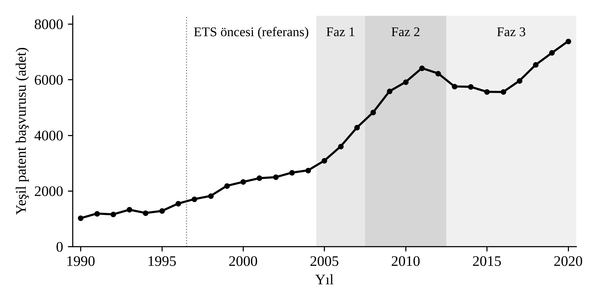
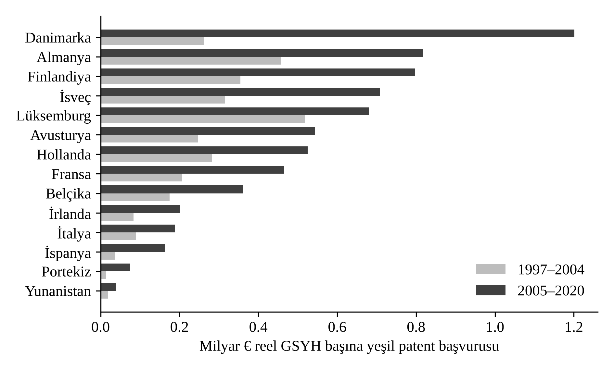
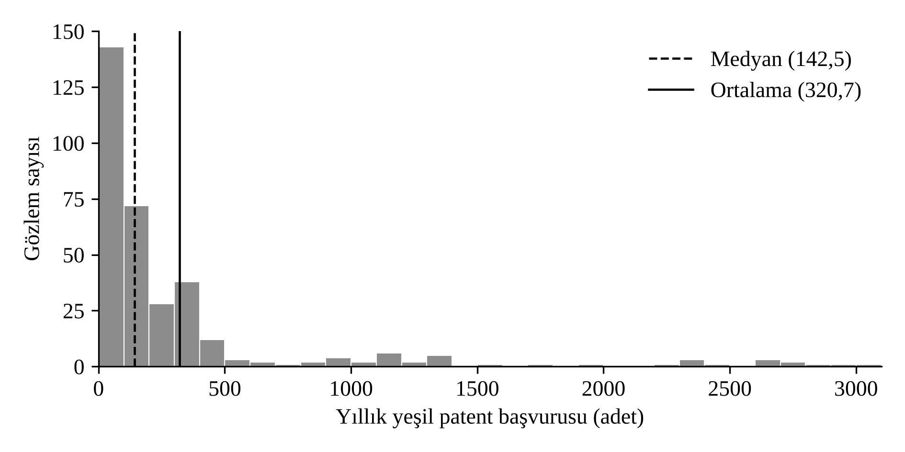
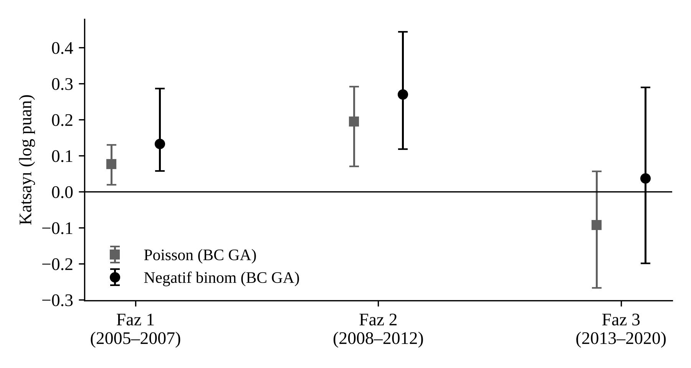
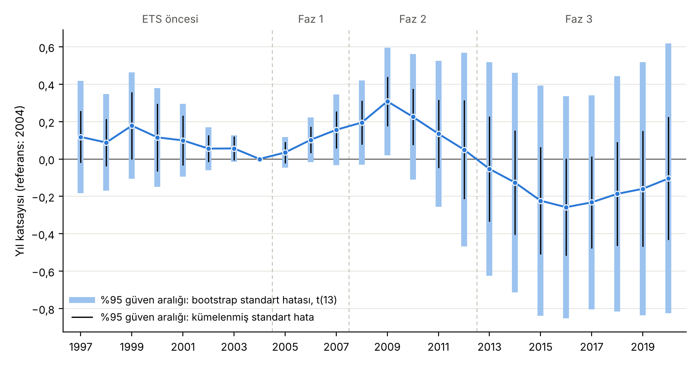

<!-- Bu dosya analiz/py/tez_guncelle.py tarafından üretilmiştir (19.11.2026). Özgün metin: Nihai_Model_19112026_metin.md. Değişiklik listesi: analiz/Tez_Guncelleme_Degisiklik_Listesi.md -->

# BEŞİNCİ BÖLÜM AB ETS'NİN YEŞİL İNOVASYON ÜZERİNDEKİ ETKİSİNİN EKONOMETRİK ANALİZİ

**5.1 Modeller ve Yöntemler**

Çalışmada kullanılan modeller, genelleştirilmiş doğrusal modeller ailesinin sayım verilerine uygulanan üyeleridir. Bu bölümde önce genelleştirilmiş doğrusal modeller, ardından sayım verileri ile bu veriler için kullanılan Poisson sözde en çok olabilirlik tahmincisi ve negatif binom modeli açıklanmaktadır.

**5.1.1 Genelleştirilmiş Doğrusal Modeller**

Genelleştirilmiş doğrusal modeller, klasik doğrusal modellerin bir genişlemesidir (McCullagh ve Nelder, 1989). Bu modellerde bağımlı değişken üstel aileden bir dağılıma uymakta ve açıklayıcı değişkenlerin etkisi uygun bir dönüşümle doğrusal hale getirilmektedir (Nelder ve Wedderburn, 1972). Normal, binom, Poisson ve gama dağılımları bu ailenin üyeleridir. Bir genelleştirilmiş doğrusal model üç bileşenden oluşmaktadır (McCullagh ve Nelder, 1989). Birincisi, rassal bileşendir. Bağımlı değişken [\\(y\_{i}\\)]{.math .inline}, üstel aileden bir dağılıma uymaktadır. İkincisi, sistematik bileşendir. Açıklayıcı değişkenler modelde [\\(\\eta\_{i} = \\mathbf{x}\_{i}\'\\mathbf{\\beta}\\)]{.math .inline} biçimindeki doğrusal öngörücüyle yer almaktadır. Üçüncüsü, bağlantı fonksiyonudur. Bağımlı değişkenin koşullu beklenen değeri [\\(\\mu\_{i} = E\\left\\lbrack y\_{i} \\mid \\mathbf{x}\_{i} \\right\\rbrack\\)]{.math .inline}, bir [\\(g( \\cdot )\\)]{.math .inline} fonksiyonu aracılığıyla doğrusal öngörücüye bağlanmaktadır:

[\\(g\\left( \\mu\_{i} \\right) = \\eta\_{i} = \\mathbf{x}\_{i}\'\\mathbf{\\beta}\\)]{.math .inline} (1)

Bağımlı değişkenin türüne göre farklı dağılımlar ve bağlantı fonksiyonları kullanılmaktadır. Bağımlı değişkenin negatif olmayan değerler aldığı durumlarda logaritmik bağlantı fonksiyonu kullanılmaktadır:

[\\(\\ln\\mu\_{i} = \\mathbf{x}\_{i}\'\\mathbf{\\beta}\\quad \\Leftrightarrow \\quad\\mu\_{i} = exp\\left( \\mathbf{x}\_{i}\'\\mathbf{\\beta} \\right)\\)]{.math .inline} (2)

Logaritmik bağlantı fonksiyonu, koşullu beklenen değerin her zaman pozitif olmasını sağlamaktadır. Çalışmada kullanılan Poisson ve negatif binom modelleri, bu ailenin sayım verilerine uygulanan üyeleridir.

**5.1.2 Sayım Verileri**

Sayım verileri, belirli bir dönemde gerçekleşen olayların sayısını gösteren ve yalnızca negatif olmayan tam sayı değerler alan verilerdir. Bu veriler doğrusal regresyonun varsayımlarıyla üç noktada bağdaşmamaktadır. Birincisi; doğrusal koşullu ortalama, negatif tahmin değerleri üretebilmektedir; ancak bir sayım değişkeninin beklenen değeri negatif olamamaktadır. İkincisi, sayım verilerinde varyans ortalamayla birlikte artmaktadır ve bu durum sabit varyans varsayımını ihlal etmektedir. Üçüncüsü, sayım değişkenleri kesikli ve sağa çarpık bir dağılım göstermektedir ve bu durum normal dağılım varsayımıyla bağdaşmamaktadır.

Bağımlı değişkenin logaritması alınarak doğrusal modelin kullanılması bu sorunları gidermemektedir. Sıfır değerli gözlemlerin logaritması tanımsızdır. Ayrıca logaritmik model, bağımlı değişkenin beklenen değerini değil, logaritmasının beklenen değerini tahmin etmektedir ([\\(E\\left\\lbrack \\ln y\_{i} \\right\\rbrack \\neq lnE\\left\\lbrack y\_{i} \\right\\rbrack\\)]{.math .inline}). Bu iki büyüklük arasındaki fark verinin yayılımına bağlıdır. Yayılım açıklayıcı değişkenlere göre değiştiğinde bu fark katsayılara yansımakta ve katsayılar yanlı tahmin edilmektedir (Santos Silva ve Tenreyro, 2006).

Bu nedenlerle sayım verileri, genelleştirilmiş doğrusal modeller ailesinin logaritmik bağlantılı iki üyesiyle modellenmektedir: Poisson modeli ve negatif binom modeli.

**5.1.3 Poisson Modeli ve Sözde En Çok Olabilirlik Tahmincisi**

Sayım verileri için temel model Poisson modelidir (Cameron ve Trivedi, 2013). Model, bağımlı değişkenin [\\(\\mu\_{i} = exp\\left( \\mathbf{x}\_{i}\'\\mathbf{\\beta} \\right)\\)]{.math .inline} parametreli Poisson dağılımına uyduğunu varsaymaktadır:

[\\(P\\left( y\_{i} = y \\right) = \\frac{e\^{- \\mu\_{i}}\\,\\mu\_{i}\^{\\, y}}{y!},\\quad\\quad y = 0,1,2,\\ldots\\)]{.math .inline} (3)

Poisson dağılımında koşullu varyans koşullu ortalamaya eşittir: [\\(Var\\left( y\_{i} \\mid \\mathbf{x}\_{i} \\right) = E\\left\\lbrack y\_{i} \\mid \\mathbf{x}\_{i} \\right\\rbrack = \\mu\_{i}\\)]{.math .inline}. Bu özellik eşit yayılım olarak adlandırılmaktadır. Katsayılar en çok olabilirlik yöntemiyle tahmin edilmektedir. Log-olabilirlik fonksiyonu sabit terimler dışında

[\\(\\ln L\\left( \\mathbf{\\beta} \\right) = \\sum\_{i = 1}\^{N}\\left\\lbrack y\_{i}\\ln\\mu\_{i} - \\mu\_{i} \\right\\rbrack\\)]{.math .inline} (4)

biçimindedir ve birinci sıra koşulları

[\\(\\sum\_{i = 1}\^{N}\\left( y\_{i} - \\mu\_{i} \\right)\\mathbf{x}\_{i} = \\mathbf{0}\\)]{.math .inline} (5)

olarak elde edilmektedir.

Poisson modelinin eşit yayılım varsayımı uygulamada çoğunlukla sağlanamamaktadır. Ancak birinci sıra koşulları, dağılımın biçimini değil yalnızca koşullu ortalamayı içermektedir. Bu nedenle koşullu ortalama doğru tanımlandığı sürece tahminci, verinin dağılımı Poisson olmasa ve eşit yayılım varsayımı sağlanmasa dahi tutarlıdır (Gourieroux ve diğ., 1984; Cameron ve Trivedi, 2013). Bu özelliğe dayanan tahminci, Poisson sözde en çok olabilirlik (QML) tahmincisi olarak adlandırılmaktadır.

Poisson sözde en çok olabilirlik tahmincisinde Poisson dağılımı, verinin gerçek dağılımına ilişkin bir varsayım olarak değil, katsayıların tahmininde kullanılan bir araç olarak işlev görmektedir. Tahmincinin dayandığı tek varsayım, koşullu ortalamanın [\\(E\\left\\lbrack y\_{i} \\mid \\mathbf{x}\_{i} \\right\\rbrack = exp\\left( \\mathbf{x}\_{i}\'\\mathbf{\\beta} \\right)\\)]{.math .inline} biçiminde doğru tanımlanmış olmasıdır. Eşit yayılım sağlanmadığında katsayılar tutarlı kalmakta, ancak Poisson dağılımına dayanan standart hatalar geçerliliğini yitirmektedir. Bu durumda standart hatalar, dağılım varsayımına karşı sağlam kovaryans matrisiyle hesaplanmaktadır (Cameron ve Trivedi, 2013).

**5.1.4 Negatif Binom Modeli**

Sayım verilerinin varyansı uygulamada çoğunlukla ortalamadan büyüktür. Bu durum aşırı yayılım olarak adlandırılmaktadır. Negatif binom modeli, Poisson ortalamasına gözlemlenemeyen bir heterojenlik terimi ekleyerek aşırı yayılıma izin vermektedir (Cameron ve Trivedi, 2013). Heterojenlik teriminin gama dağılımına uyduğu varsayıldığında negatif binom dağılımı elde edilmektedir. En yaygın biçimi olan ve NB2 olarak adlandırılan negatif binom modelinde olasılık fonksiyonu

[\\(P\\left( y\_{i} = y \\right) = \\frac{\\Gamma\\left( y + \\alpha\^{- 1} \\right)}{\\Gamma(y + 1)\\,\\Gamma\\left( \\alpha\^{- 1} \\right)}\\left( \\frac{\\alpha\^{- 1}}{\\alpha\^{- 1} + \\mu\_{i}} \\right)\^{\\alpha\^{- 1}}\\left( \\frac{\\mu\_{i}}{\\alpha\^{- 1} + \\mu\_{i}} \\right)\^{y}\\)]{.math .inline} (6)

biçimindedir. Koşullu ortalama Poisson modelindeki ile aynıdır ([\\(\\mu\_{i} = exp\\left( \\mathbf{x}\_{i}\'\\mathbf{\\beta} \\right)\\)]{.math .inline}). Koşullu varyans ise ortalamanın karesel bir fonksiyonudur:

[\\(Var\\left( y\_{i} \\mid \\mathbf{x}\_{i} \\right) = \\mu\_{i} + \\alpha\\,\\mu\_{i}\^{2}\\)]{.math .inline} (7)

Burada [\\(\\alpha\\)]{.math .inline} aşırı yayılım parametresidir ve katsayılarla birlikte en çok olabilirlik yöntemiyle tahmin edilmektedir. [\\(\\alpha = 0\\)]{.math .inline} olduğunda model Poisson modeline indirgenmektedir. Aşırı yayılım bulunduğunda ve varyans fonksiyonu doğru tanımlandığında negatif binom modeli Poisson tahmincisine göre daha etkin tahminler üretmektedir.

Aşırı yayılımın varlığı, [\\(H\_{0}:\\alpha = 0\\)]{.math .inline} hipotezi için olabilirlik oranı testiyle sınanmaktadır:

[\\(LR = 2\\left( \\ln L\_{NB} - lnL\_{Poisson} \\right)\\)]{.math .inline} (8)

Sıfır hipotezi altında [\\(\\alpha\\)]{.math .inline} parametre uzayının sınırında yer aldığından, test istatistiği standart ki-kare dağılımına değil, yarısı sıfırda yığılmış bir serbestlik dereceli ki-kare dağılımına uymaktadır.

**5.1.5 Sabit Etkili Panel Sayım Modeli**

Panel verilerde Poisson ve negatif binom modellerinin koşullu ortalaması, birim sabit etkileri ve maruziyet terimiyle birlikte aşağıdaki genel biçimde tanımlanmaktadır:

[\\(E\\left\\lbrack y\_{it} \\mid \\mathbf{x}\_{it},c\_{i} \\right\\rbrack = \\mu\_{it} = exp\\left( c\_{i} + \\mathbf{x}\_{it}\'\\mathbf{\\beta} + lne\_{it} \\right)\\)]{.math .inline} (9)

Burada [\\(y\_{it}\\)]{.math .inline}, [\\(i\\)]{.math .inline} biriminin [\\(t\\)]{.math .inline} dönemindeki sayım değişkenini, [\\(\\mu\_{it}\\)]{.math .inline} bu değişkenin koşullu beklenen değerini göstermektedir. [\\(c\_{i}\\)]{.math .inline} birim sabit etkisidir ve birimlerin zaman içinde değişmeyen, gözlemlenemeyen özelliklerini temsil etmektedir. [\\(\\mathbf{x}\_{it}\\)]{.math .inline} açıklayıcı değişkenler vektörü, [\\(\\mathbf{\\beta}\\)]{.math .inline} ise katsayı vektörüdür. [\\(e\_{it}\\)]{.math .inline} maruziyet değişkenidir. Maruziyet değişkeni birimlerin büyüklük farklılıklarını yansıtmakta ve logaritması modele katsayısı bire sabitlenerek girmektedir. Bu kısıt altında model, maruziyet birimi başına beklenen olay sayısını açıklamaktadır:

[\\(\\frac{\\mu\_{it}}{e\_{it}} = exp\\left( c\_{i} + \\mathbf{x}\_{it}\'\\mathbf{\\beta} \\right)\\)]{.math .inline} (10)

Koşullu ortalama üstel biçimde tanımlandığından katsayılar oransal etkiler olarak yorumlanmaktadır. Katsayının üstel dönüşümü olay hızı oranı (IRR) olarak adlandırılmakta ve ilgili değişkendeki bir birimlik artışın beklenen değeri kaç katına çıkardığını göstermektedir:

[\\(IRR\_{k} = exp\\left( \\beta\_{k} \\right)\\)]{.math .inline} (11)

Kukla değişkenlerde ise yüzde etki [\\(100\\left\\lbrack \\exp\\left( \\beta\_{k} \\right) - 1 \\right\\rbrack\\)]{.math .inline} ile hesaplanmaktadır. Logaritmik biçimde tanımlanan değişkenlerin katsayıları ise esneklik olarak yorumlanmaktadır.

Sabit etkilerin tahmini iki modelde farklı özellikler taşımaktadır. Poisson modelinde sabit etkilerin birim kuklalarıyla tahmin edilmesi, koşullu en çok olabilirlik tahmincisiyle aynı katsayıları vermekte ve tesadüfi parametre sorununa yol açmamaktadır (Cameron ve Trivedi, 2013; Allison ve Waterman, 2002). Sabit etkili Poisson tahmincisi ayrıca dağılım varsayımına karşı sağlamdır (Wooldridge, 1999; Cameron ve Trivedi, 2013). Negatif binom modelinde ise Hausman ve diğ. (1984) tarafından önerilen koşullu sabit etkili tahminci, birim etkisini koşullu ortalamaya değil aşırı yayılım parametresine bağlamaktadır. Bu tahminci, koşullu ortalamadaki birim farklılıklarını tam olarak kontrol etmediğinden gerçek bir sabit etkiler tahmincisi değildir (Allison ve Waterman, 2002). Bu nedenle negatif binom modelinde sabit etkiler, birim kuklalarının modele doğrudan eklenmesiyle tahmin edilmektedir.

#### **5.1.6 Kukla Değişkenli Model**

Kukla değişken, bir durumun ya da dönemin varlığını gösteren ve yalnızca 0 ve 1 değerlerini alan değişkendir. Bir politikanın birbirini izleyen [\\(K\\)]{.math .inline} uygulama dönemi bulunduğunda, her dönem için ayrı bir kukla değişken tanımlanmaktadır:

[\\(\\ln\\mu\_{it} = c\_{i} + \\sum\_{k = 1}\^{K}\\delta\_{k}D\_{kt} + \\mathbf{x}\_{it}\'\\mathbf{\\beta}\\)]{.math .inline} (12)

Burada [\\(D\_{kt}\\)]{.math .inline}, [\\(k\\)]{.math .inline} döneminin yıllarında 1, diğer yıllarda 0 değerini almaktadır. Politika öncesi dönem için kukla tanımlanmamakta ve bu dönem referans kategoriyi oluşturmaktadır. [\\(\\delta\_{k}\\)]{.math .inline} katsayısı, diğer değişkenler sabitken [\\(k\\)]{.math .inline} dönemindeki koşullu beklenen değerin referans döneme göre logaritmik farkını göstermektedir. Bu model her dönem için tek bir ortalama etki tahmin etmekte, dönem içindeki zaman seyrini ise modellememektedir.

#### **5.1.7 Segmentli Kesintili Zaman Serisi Modeli**

Kesintili zaman serisi modeli; bir müdahalenin etkisini, müdahale öncesi eğilimin müdahale sonrasına uzatılmış değeriyle karşılaştırarak ölçmektedir. Tasarımın standart tahmin yöntemi segmentli regresyondur (Wagner ve diğ., 2002; Bernal ve diğ., 2017):

[\\(y\_{t} = \\beta\_{0} + \\beta\_{1}T\_{t} + \\beta\_{2}X\_{t} + \\beta\_{3}\\left( T\_{t} - T\_{0} \\right)X\_{t} + \\varepsilon\_{t}\\)]{.math .inline} (13)

Burada [\\(T\_{t}\\)]{.math .inline} zaman değişkenini, [\\(T\_{0}\\)]{.math .inline} müdahalenin başladığı dönemi, [\\(X\_{t}\\)]{.math .inline} ise müdahale sonrasında 1, öncesinde 0 değerini alan kuklayı göstermektedir. [\\(\\beta\_{0}\\)]{.math .inline} başlangıç düzeyini, [\\(\\beta\_{1}\\)]{.math .inline} müdahale öncesi eğilimi ölçmektedir. [\\(\\beta\_{2}\\)]{.math .inline} müdahalenin başladığı dönemdeki düzey değişimini, [\\(\\beta\_{3}\\)]{.math .inline} ise müdahale sonrasında eğimdeki değişimi göstermektedir. Müdahale sonrası eğim [\\(\\beta\_{1} + \\beta\_{3}\\)]{.math .inline} biçimindedir.

Birden fazla müdahale dönemi bulunduğunda her dönem için ayrı bir düzey ve eğim terimi modele eklenmektedir. Bağımlı değişken sayım verisi olduğunda aynı terimler Poisson ya da negatif binom modelinin doğrusal öngörücüsüne dahil edilmektedir. Tasarımın temel varsayımı, müdahale olmasaydı müdahale öncesi eğilimin devam edeceğidir.

**5.1.8 Kümelenmiş Bootstrap**

Panel verilerde aynı birime ait gözlemlerin hata terimleri zaman boyunca ilişkili olabildiğinden, standart hatalar birim düzeyinde kümelenmektedir. Ancak küme sayısı az olduğunda asimptotik kümelenmiş varyans tahmincisi standart hataları olduğundan küçük tahmin etmekte ve hipotez testlerinde birinci tip hata olasılığını (gerçekte doğru olan sıfır hipotezinin reddedilme olasılığı) artırmaktadır (Cameron ve diğ., 2008). MacKinnon ve Webb (2017), kümelerin birbirinden çok farklı olduğu durumlarda asimptotik kümelenmiş standart hataların daha da güvenilmez hâle geldiğini göstermiştir. Bu çalışmalar az sayıda küme için wild kümelenmiş bootstrap yöntemini önermektedir; ancak bu yöntem esas olarak doğrusal modeller için geliştirilmiştir. Bu çalışmada, doğrusal olmayan sayım modellerine doğrudan uygulanabildiği için kümelenmiş eşli bootstrap kullanılmıştır. Küme sayısı az ve kümelerin tahmindeki ağırlıkları dengesiz olduğunda eşli bootstrap standart hataları da iyimser olabilmektedir; bu nedenle bulgular küme jackknife yöntemiyle ayrıca sınanmıştır.

Bootstrap prosedüründe her tekrarda kümeler yerine konularak yeniden örneklenmekte, seçilen her küme tüm gözlemleriyle birlikte alınmakta, birden fazla kez seçilen kümeler ayrı birimler olarak kabul edilerek kendi sabit etkilerini almakta ve model yeniden tahmin edilmektedir. B tekrar sonunda standart hata, bootstrap katsayı dağılımının standart sapması olarak hesaplanmaktadır:

[\\\[{\\widehat{se}}\_{B}\\left( \\widehat{\\beta} \\right) = \\left\\lbrack \\frac{1}{B - 1}\\sum\_{b = 1}\^{B}\\left( {\\widehat{\\beta}}\_{b}\^{\*} - {\\bar{\\beta}}\^{\*} \\right)\^{2} \\right\\rbrack\^{1/2}\\\]]{.math .display} (14)

Güven aralıkları, yüzdelik yöntemle ya da sapma düzeltmeli yöntemle hesaplanmaktadır (Efron ve Tibshirani, 1993). Sapma düzeltmeli yöntemde önce bootstrap dağılımının nokta tahminine göre medyan sapması tahmin edilmektedir:

[\\\[{\\widehat{z}}\_{0} = \\Phi\^{- 1}\\left( \\frac{\\#\\{{\\widehat{\\beta}}\_{b}\^{\*} \< \\widehat{\\beta}\\}}{B} \\right)\\\]]{.math .display} (15)

Ardından güven aralığının sınırları, bootstrap dağılımının düzeltilmiş yüzdeliklerinden alınmaktadır:

[\$\$\\left\\lbrack {\\widehat{\\beta}}\_{\\left( q\_{1} \\right)}\^{\*},\\mspace{6mu}{\\widehat{\\beta}}\_{\\left( q\_{2} \\right)}\^{\*} \\right\\rbrack,\\quad\\quadq\_{1} = \\Phi\\left( 2{\\widehat{z}}\_{0} + z\_{0,025} \\right),\\quadq\_{2} = \\Phi\\left( 2{\\widehat{z}}\_{0} + z\_{0,975} \\right)\$\$]{.math .display} (16)

Sapma düzeltmeli aralık, bootstrap dağılımının nokta tahmini etrafında yaklaşık simetrik olduğu durumlar için uygundur. Bootstrap dağılımı nokta tahminine göre belirgin biçimde kaymışsa [\\({\\widehat{z}}\_{0}\\)]{.math .inline} büyümekte ve aralık kararsızlaşmaktadır; bu nedenle sapma düzeltmeli aralıkların yanında yüzdelik aralıklar da raporlanmıştır.

Ortak hipotezler, bootstrap kovaryans matrisiyle hesaplanan Wald istatistiğiyle sınanmaktadır.

Eşli bootstrap, modelin tamamını her yeniden örneklemde yeniden tahmin ettiğinden, doğrusal olmayan tahmincilere doğrudan uygulanabilmekte ve kümeler arasındaki heterojenliği doğal biçimde yansıtmaktadır.

Küme jackknife yönteminde model, her seferinde bir küme dışarıda bırakılarak [\\(G\\)]{.math .inline} kez yeniden tahmin edilmekte ve varyans

[\\\[{\\widehat{V}}\_{JK}\\left( \\widehat{\\beta} \\right) = \\frac{G - 1}{G}\\sum\_{g = 1}\^{G}\\left( {\\widehat{\\beta}}\_{(g)} - \\bar{\\beta} \\right)\^{2}\\\]]{.math .display} (17)

biçiminde hesaplanmaktadır. Burada [\\({\\widehat{\\beta}}\_{(g)}\\)]{.math .inline}, [\\(g\\)]{.math .inline} kümesi dışarıda bırakıldığında elde edilen tahmini, [\\(\\bar{\\beta}\\)]{.math .inline} ise bu tahminlerin ortalamasını göstermektedir. Test istatistiği [\\(G - 1\\)]{.math .inline} serbestlik dereceli [\\(t\\)]{.math .inline} dağılımıyla değerlendirilmektedir. Az sayıda ve dengesiz kümelerde bu yöntem, kümelenmiş ve bootstrap standart hatalarına göre daha temkinli sonuç vermektedir (MacKinnon, Nielsen ve Webb, 2023).

**5.2 Model Tanımı**

AB ETS'nin yeşil inovasyon üzerindeki etkisi, 14 AB üyesi ülke için 1997--2020 dönemini kapsayan bir panel veri seti ile tahmin edilmektedir. Bu amaçla geliştirilen birinci modelde, AB ETS'nin üç fazında uygulanan farklı izin tahsisat politikalarının yeşil inovasyon üzerindeki etkisinin, ETS öncesi dönem ile karşılaştırılarak gösterilmesi amaçlanmıştır. Şu an içinde bulunulan dördüncü faz, 2030 yılında tamamlanacağı için analize dahil edilmemiştir. İkinci modelde ise, her fazın etkisi ETS öncesi eğilime göre düzey ve eğim bileşenlerine ayrıştırılmıştır.

ETS öncesi dönem (1997--2004) referans dönem olarak kullanılmakta, her fazdaki yeşil patent yoğunluğu bu referans döneme göre ölçülmektedir. Referans dönem, sistemin fiilen başladığı 2005 yılından önceki bütün tahmin yıllarını kapsamaktadır. 2003/87/AT sayılı Direktif Ekim 2003'te kabul edildiğinden 2003--2004 yıllarında beklenti etkileri oluşmuş olabilir; bu nedenle referans dönemin 1997--2002 ile sınırlandırıldığı tahmin sağlamlık testi olarak sunulmuştur (Bölüm 5.8.1). Modeller üç temel unsuru esas almaktadır. Birincisi, AB ETS fazları örneklemi oluşturan 14 ülke için ortak ve dışsal olarak belirlenmiş uygulama dönemlerini temsil etmektedir. Fazların başlangıç ve bitiş tarihleri, AB düzeyindeki yasama süreçlerinde, ülkelerin inovasyon faaliyetinden bağımsız olarak belirlenmiştir; ilk iki fazda tahsis miktarları ise üye devletlerin Komisyon onayına sunduğu Ulusal Tahsis Planlarıyla saptanmıştır. Dolayısıyla, faz takvimi ile inovasyon arasında ters nedensellik ilişkisi bulunmamaktadır. Diğer bir deyişle, fazların inovasyon üzerinde etkili olması beklenirken tersi söz konusu olamamaktadır. İkincisi, sekiz yıllık referans dönemi (1997-2004), ETS öncesi yeşil patent yoğunluğu eğiliminin modellenmesine imkân vermektedir. Üçüncüsü, yeşil inovasyonu AB ETS dışında etkileyebilecek faktörler olan ülke sabit etkileri, yeşil patent stoku ve gecikmeli kontrol değişkenlerine modellerde yer verilmiştir.

Birinci model, AB ETS'nin her bir fazda yeşil patent yoğunluğunun ETS öncesi döneme kıyasla gösterdiği ortalama farklılaşmayı tahmin etmektedir. İkinci model ise segmentli kesintili zaman serisi tasarımı çerçevesinde, yeşil patent yoğunluğunun ETS öncesi doğrusal eğilimini kontrol altına alarak her fazın etkisini düzey ve eğim bileşenlerine ayrıştırmaktadır. Her iki model, ülke sabit etkili negatif binom modeli ve Poisson sözde en çok olabilirlik tahmincisiyle tahmin edilmektedir. Tahmin edilen farkların zamanlaması, yıl etkileri modeli ve ETS öncesi döneme yerleştirilen plasebo kırılma testleriyle incelenmektedir. Örneklemdeki bütün ülkeler AB ETS'ye aynı tarihte dâhil olduğundan tasarım bir önce--sonra karşılaştırmasıdır; tahmin edilen faz farkları aynı dönemde gerçekleşen diğer ortak gelişmelerin etkisini de içerebilir. Bu nedenle bulgular nedensel etki olarak değil, AB ETS fazlarıyla ilişkili farklar olarak yorumlanmaktadır (Bölüm 5.11).

## 5.3 Hipotezler

Tezin hipotezleri, Porter hipotezi (Porter ve van der Linde, 1995) çerçevesinde geliştirilmiştir.

**H1:** AB ETS'nin yürürlüğe girmesi, ETS öncesi döneme kıyasla yeşil patent yoğunluğunu artırmıştır.

> **H2:** AB ETS'nin birinci fazı (2005--2007), ETS öncesi döneme kıyasla yeşil patent yoğunluğunda pozitif bir etki yaratmıştır.
>
> **H3:** AB ETS'nin ikinci fazı (2008--2012), yeşil patent yoğunluğu üzerinde birinci fazdan daha güçlü bir etki yaratmıştır.
>
> **H4:** AB ETS'nin üçüncü fazı (2013--2020), yeşil patent yoğunluğu üzerinde ikinci fazdan daha güçlü bir etki yaratmıştır.
>
> **H5:** Birinci fazdaki hızlanma ve ikinci fazın başındaki düzey artışı, ETS öncesi eğilim hesaba katıldığında da ortaya çıkmaktadır.

### 5.4 Değişkenlerin Belirlenmesi

Modellerde dört farklı değişken türü kullanılmıştır: Bağımlı değişken, maruziyet değişkeni, kukla değişkenleri ve kontrol değişkenleri.

### 5.4.1 Bağımlı Değişken

Bağımlı değişken [\\(y\_{it}\\)]{.math .inline}, [\\(i\\)]{.math .inline} ülkesinin [\\(t\\)]{.math .inline} yılında iklim değişikliği azaltım teknolojilerinde yaptığı Avrupa Patent Ofisi (EPO) başvurularının sayısıdır. Veriler OECD'nin çevreyle ilgili teknolojilere ilişkin patent istatistiklerinden elde edilmiştir. Başvurular öncelik tarihine ve başvuru sahibinin ikamet ettiği ülkeye göre derlenmiştir. Öncelik tarihi, buluşun ilk kez herhangi bir patent ofisine başvurulduğu tarih olduğundan icat faaliyetinin zamanlamasına en yakın göstergedir. Başvuru sahiplerinin birden fazla ülkede ikamet ettiği patentler, OECD'nin kesirli sayım yöntemiyle başvuru sahiplerinin ülkelerine payları oranında dağıtılmaktadır. Çalışmada, elde edilen ülke-yıl değerleri sayım veri modelleriyle uyumlu olması amacıyla en yakın tam sayıya, yarım değerler yukarı yuvarlanmıştır. Yuvarlanmamış değerlerle yapılan Poisson tahmininde faz katsayıları üçüncü ondalıkta aynıdır (0,0774 ve 0,1955).

EPO başvurularının kullanılması iki avantaj sağlamaktadır. Birincisi, tüm ülkelerin başvuruları aynı patent ofisinin kurallarına, ücretlerine ve inceleme standartlarına tabi olduğundan, ulusal patent sistemleri arasındaki farklılıklardan kaynaklanan karşılaştırılabilirlik sorunları ortadan kalkmaktadır. İkincisi, EPO başvuruları ulusal başvurulara göre daha maliyetli olduğundan, birden fazla Avrupa ülkesinde koruma talep edilen ve dolayısıyla belirli bir ticari değer taşıyan buluşları yansıtmaktadır.

Bu çalışmada yeşil inovasyon, Avrupa Patent Ofisine yapılan iklim değişikliği azaltım teknolojisi patent başvurularıyla ölçülmektedir. Patent başvuruları buluş faaliyetinin göstergesidir; buluşların niteliğini, yayılmasını ve çevresel etkisini doğrudan ölçmez. Bu nedenle bulgular yeşil patentleme faaliyetine ilişkindir. Ayrıca en son yıllara ait başvuru sayıları, verinin derlendiği tarihe bağlı olarak eksik olabilmektedir; 2018--2020 yılları dışarıda bırakıldığında bulgular zayıflamamaktadır (Bölüm 5.8.1).

Örneklemde yıllık yeşil patent başvuru sayısı 1 ile 3.041 arasında değişmekte ve hiçbir gözlemde sıfır değer bulunmamaktadır. Sıfır değer gözlenebilir olduğundan (tahmin dönemi öncesinde Portekiz için 1990 yılında sıfır başvuru vardır) sıfır-kesikli bir model gerekmemektedir; sıfır-kesikli negatif binom tahmininde katsayılar yalnızca dördüncü ondalıkta değişmektedir (birinci faz 0,1342; ikinci faz 0,2709). Başvuruların dağılımı ülkeler arasında belirgin biçimde çarpıktır. 1997--2020 döneminde 14 ülkenin toplam 107.759 başvurusunun yaklaşık %45'i Almanya'ya, % 18'i Fransa'ya aittir. Esas alınan 14 AB üyesi ülkenin toplam yeşil patent başvuruları 1997'de 1.707 iken 2011'de 6.414'e yükselmiş, 2013--2016 döneminde 5.550--5.760 aralığında yatay bir seyir izlemiş ve 2020'de 7.381'e ulaşmıştır (OECD, 2026). Yeşil patent başvuru sayılarının ETS öncesi ve ETS sonrası üç faza göre dağılımı Şekil 5.1'deki gibidir.

**Şekil 5.1.** 14 AB Üyesi Ülkelerinin Toplam Yeşil Patent Başvuru Sayısı (1990--2020)

**5.4.2 Maruziyet Değişkeni**

Ülkeler arasında ve ülkelerin kendi içinde zaman içinde gelişen ekonomik büyüklük farklılıkları, patent başvurularının sayısını AB ETS'den bağımsız olarak etkilemektedir. Gelişmiş ekonomiler daha fazla patent üretmekte, bir ülkede ekonomik büyüklüğün artması da patent sayısını artırmaktadır. GSYİH maruziyet değişkeni olarak modelde yer aldığı için faz katsayıları, ekonomik büyümeden arındırılmış etkiyi göstermektedir. Modelde açıklanan büyüklük, reel GSYİH başına patent başvuru sayısı diğer bir deyişle yeşil patent yoğunluğudur. Reel GSYİH verisi Eurostat ulusal hesaplar veri tabanından, 2015 yılı zincirlenmiş hacim değerleriyle, milyar avro cinsinden derlenmiştir. ETS öncesi ve sonrası, ülkelere göre hesaplanan yeşil patent yoğunluğu değerleri, Şekil 5.2'de yer almaktadır. Yoğunluk, örneklemdeki tüm ülkelerde ETS döneminde ETS öncesine göre daha yüksektir. ETS döneminde en yüksek yoğunluk Danimarka, Almanya, Finlandiya ve İsveç'te, en düşük yoğunluk ise Yunanistan, Portekiz ve İspanya'da gözlemlenmektedir; ETS öncesi dönemde en yüksek ortalama yoğunluk Lüksemburg'a aittir (0,52).

**Şekil 5.2.** Ülkelere Göre Ortalama Yeşil Patent Yoğunluğu

### 5.4.3 Politika Değişkenleri {#politika-değişkenleri-1}

Politika değişkenleri, AB ETS'nin üç uygulama fazını temsil eden kukla değişkenlerdir. İzin tahsis yöntemi birbirinden farklı ardışık fazlar hâlinde uygulandığından, yeşil inovasyon üzerindeki etkisi tek bir değişkenle değil, her faz için ayrı tanımlanan değişkenlerle ölçülmektedir. Birinci, ikinci ve üçüncü faz kukla değişkenleri sırasıyla F1, F2 ve F3 şeklinde modelde tanımlanmıştır. Her kukla, ilgili fazın yıllarında 1, diğer yıllarda 0 değerini almaktadır. ETS öncesi dönem (1997--2004) referans dönem olduğundan, her faz kuklasının katsayısı, ilgili fazdaki yeşil patent yoğunluğunun ETS öncesi döneme göre farkını göstermektedir. Böylece her fazın etkisi ayrı ayrı tahmin edilmekte ve etkinin fazların arasında farklılaşıp farklılaşmadığı sınanabilmektedir.

### 5.4.4 Kontrol Değişkenleri

Modelde yeşil patent stoku ile beş kontrol değişkeni (GSYİH büyüme oranı, yenilenebilir enerji payı, enerji ithalat bağımlılığı, imalat sanayi payı ve dış ticaret açıklığı) yer almaktadır. Tüm kontrol değişkenleri, eşzamanlılık sorununu azaltmak ve patent başvurularının gecikmeli tepkisini yansıtmak amacıyla bir dönem gecikmeli olarak modele girmektedir.

**Yeşil patent stoku.** Bilgi üretim fonksiyonu ve yönlendirilmiş teknik değişim yaklaşımı, birikmiş bilginin yeni bilgi üretiminin temel girdisi olduğunu öngörmektedir (Popp, 2002; Aghion ve diğ., 2016). Yeşil patent stoku, ülkenin iklim değişikliği azaltım teknolojilerinde biriktirdiği teknolojik kapasiteyi, bu alandaki araştırmacı ve mühendis birikimini ve kurumsal altyapıyı yansıtmaktadır. Stok, sürekli envanter yöntemiyle hesaplanmıştır:

K~i,t~ = (1 − δ)K~i,t−1~ + P~i,t~ (18)

Burada P~i,t~ yeşil patent başvuru sayısını, δ = 0,15 yıllık eskime oranını göstermektedir (Hall ve Mairesse, 1995; Popp, 2002; Noailly ve Smeets, 2015). Başlangıç stoku K~i,1990~ = P~i,1990~ / (g + δ) biçiminde hesaplanmıştır; g, 14 ülkenin toplam yeşil patent başvurularının 1990--1996 dönemindeki ortalama yıllık logaritmik büyümesidir (0,0691). Yeşil patent stoku birikmiş patent çıktısını ölçmekte ve ülkelerin Ar-Ge kapasitesinin dolaylı bir göstergesi olarak kullanılmaktadır; Ar-Ge harcamaları modelde ayrıca yer almamaktadır.

**GSYİH büyüme oranı.** İktisadi büyüme ile yeşil patent yoğunluğu üzerinde iki zıt etki ortaya çıkabilmektedir. İlki, firmaların Ar-Ge'ye ayırabileceği kaynaklar ve yeni teknolojilere yönelik talep artışı patent yoğunluğunu artırabilmektedir. Ancak, patent başvuru oranının, büyüme oranından düşük olması durumunda yeşil patent yoğunluğu düşebilmektedir. Bu nedenle beklenen ilişki kuramsal olarak belirsizdir.

**Yenilenebilir enerji payı.** Yenilenebilir enerjinin nihai enerji tüketimindeki payı, düşük karbonlu teknolojilerin yurt içi piyasa büyüklüğünü ve ulusal yenilenebilir enerji destek politikalarının yoğunluğunu yansıtmaktadır. Yenilenebilir enerji politikalarının bu alandaki patent başvurularını anlamlı biçimde etkilediği gösterilmiştir (Johnstone ve diğ., 2010). Bu değişken, yenilenebilir enerji politikalarının etkisinin AB ETS etkisinden ayrıştırılmasını sağlamaktadır (Bel ve Joseph, 2018).

**Enerji ithalat bağımlılığı.** Enerji ithalatına bağımlılığın yüksek olması, enerji maliyetleri ve arz güvenliği bakımından baskı yaratarak enerji teknolojilerine yönelik inovasyonu teşvik edebilmektedir.

**İmalat sanayi payı.** İmalat sanayinin ekonomideki payı, AB ETS kapsamındaki emisyon yoğun faaliyetlerin ağırlığını yansıtmaktadır. Yüksek imalat payı düşük karbonlu süreç teknolojilerine talebi artırabileceği gibi, yerleşik ve karbon yoğun teknolojilere bağımlı bir üretim yapısını da yansıtabilmektedir. Bu nedenle iki değişken arasındaki ilişkinin yönü belirsizdir.

**Dış ticaret açıklığı.** Dış ticaret, uluslararası bilgi yayılmaları ve buluşların satılabileceği piyasayı genişletmesi yoluyla inovasyonu artırabilmektedir. Ayrıca dışa açıklık, düşük karbonlu teknolojilerin yurt içinde geliştirilmesi yerine ithalat yoluyla edinilmesini kolaylaştırabilmektedir. Bu nedenle beklenen işaret belirsizdir.

**5.5 Verilerin Toplanması**

Örneklem, 14 AB üyesi ülkeden oluşmaktadır: Almanya, Avusturya, Belçika, Danimarka, Finlandiya, Fransa, Hollanda, İrlanda, İspanya, İsveç, İtalya, Lüksemburg, Portekiz ve Yunanistan. Tahmin dönemi 1997--2020 yıllarını kapsamaktadır. Panel tam dengelidir: 14 ülke ve 24 yıl olmak üzere toplam 336 gözlem bulunmaktadır. Bu gözlemlerin 112'si ETS öncesi referans dönemine (1997--2004), 42'si birinci faza (2005--2007), 70'i ikinci faza (2008--2012), 112'si ise üçüncü faza (2013--2020) aittir. Örneklem, ETS öncesi referans dönemin tamamında AB üyesi olan on beş ülkeden on dördünü kapsamaktadır. Birleşik Krallık 2020 sonuna kadar AB ETS kapsamında kalmış olmakla birlikte ana örnekleme alınmamıştır; bu durum çalışmanın bir sınırlılığıdır (Bölüm 5.11). Reel GSYİH serisi 1995'ten, GSYİH büyüme oranı 1996'dan itibaren bütün ülkeler için mevcuttur; kontrol değişkenleri bir dönem gecikmeli olarak modele girdiğinden tahmin döneminin ilk yılı 1997'dir. Yeşil patent stokunun hesaplanması amacıyla, yeşil patent sayısının 1990-2020 dönemine ait verileri esas alınmıştır. Dönem başlangıcı olarak 1990 yılının seçiminin nedenlerinden birincisi, ilgili yılın küresel iklim değişikliği raporlarında baz yılı olarak dikkate alınması ve ikincisi, patent ofisleri arasında yapılan ortak çalışmalar ile yeşil patent istatistiklerinin bu yıldan itibaren daha güvenilir biçimde izlenebilmesidir (Dechezleprêtre ve diğ., 2011; Veefkind ve diğ., 2012; Haščič ve Migotto, 2015).

Tablo 5.1, modelde kullanılan değişkenlerin tanımlarını ve veri kaynağını göstermektedir.

**Tablo 5.1.** Değişkenlerin Tanımı ve Kaynakları

  --------------------------------------------------------------------------------------------------------------------------------------------------------------------------------------------------------------------------------------------------
  **Değişken**                                                      **Tanım**                                                                                                                   **Kaynak**                       **Değişken Türü**
  ----------------------------------------------------------------- --------------------------------------------------------------------------------------------------------------------------- -------------------------------- -------------------
  Yeşil patent                                                      İklim değişikliği azaltım teknolojisi patenti almak için EPO'ya yapılan başvurular; öncelik tarihi, başvuru sahibi ülkesi   OECD                             Bağımlı değişken

  GSYİH                                                             Reel GSYİH, zincirlenmiş hacim (2015), milyar avro cinsinden                                                                Eurostat (nama_10_gdp)           Maruziyet

  [\\\[\\ln\\left( 1 + K\_{i,t - 1} \\right)\\\]]{.math .display}   Yeşil patent stokunun logaritması (δ = 0,15), bir dönem gecikmeli                                                           Yazar hesaplaması                Kontrol

  GSYİH büyüme oranı                                                Reel GSYİH'nin yıllık yüzde değişimi                                                                                        Eurostat (nama_10_gdp)           Kontrol

  Yenilenebilir enerji payı                                         Yenilenebilir enerjinin nihai enerji tüketimindeki payı (%)                                                                 Dünya Bankası (EG.FEC.RNEW.ZS)   Kontrol

  Enerji ithalat bağımlılığı                                        (Enerji ithalatı − Enerji ihracatı) / Brüt mevcut enerji × 100                                                              Eurostat (nrg_ind_id)            Kontrol

  İmalat payı                                                       İmalat sanayi katma değerinin GSYİH'ye oranı (%)                                                                            Dünya Bankası (NV.IND.MANF.ZS)   Kontrol

  Dış ticaret açıklığı                                              İhracat ve ithalat toplamının GSYİH'ye oranı (%)                                                                            Dünya Bankası (NE.TRD.GNFS.ZS)   Kontrol

  Kukla Değ.                                                        AB ETS üç faza ait kukla değişkenler                                                                                                                         Kukla
  --------------------------------------------------------------------------------------------------------------------------------------------------------------------------------------------------------------------------------------------------

### 5.5.1 Tanımlayıcı İstatistikler

Tablo 5.2'de değişkenlerin tanımlayıcı istatistikleri sunulmaktadır.

**Tablo 5.2.** Tanımlayıcı İstatistikler (N = 336)

  -------------------------------------------------------------------------------------------------------------------------------
  **Değişken**                                                      **Ortalama**   **Std. sapma**   **En küçük**   **En büyük**
  ----------------------------------------------------------------- -------------- ---------------- -------------- --------------
  Yeşil Patent Başvuruları (adet)                                   320,71         559,86           1              3.041

  Reel GSYİH (milyar €)                                             746,61         830,51           29,49          3.332,80

  Yeşil patent yoğunluğu (milyar € başına)                          0,395          0,341            0,006          2,117

  [\\\[\\ln\\left( 1 + K\_{i,t - 1} \\right)\\\]]{.math .display}   6,120          1,678            2,030          9,688

  GSYİH büyüme oranı (%, [\\(t - 1\\)]{.math .inline})              2,101          2,940            −9,900         24,600

  Yenilenebilir enerji payı (%, [\\(t - 1\\)]{.math .inline})       16,060         12,780           1,100          52,900

  Enerji ithalat bağımlılığı (%, [\\(t - 1\\)]{.math .inline})      61,322         27,415           −50,618        99,598

  İmalat payı (%, [\\(t - 1\\)]{.math .inline})                     14,641         4,861            4,554          34,891

  Dış ticaret açıklığı (%, [\\(t - 1\\)]{.math .inline})            104,105        66,671           36,821         382,661
  -------------------------------------------------------------------------------------------------------------------------------

Yeşil patent başvurularının standart sapması, ortalamanın yaklaşık 1,7 katıdır. İlgili değişkenin varyansı ortalamadan büyüktür ve dağılımı sağa çarpıktır (Şekil 5.3). Gözlemlerin yarısında yıllık başvuru sayısı 143'ün altındadır; ortalama (320,7) medyanın (142,5) iki katından büyüktür ve çarpıklık katsayısı 3,1'dir. Bu özellikler, sayım modellerinin kullanılmasını gerektirmektedir. Enerji ithalat bağımlılığının negatif en küçük değeri, dönemin bir bölümünde net enerji ihracatçısı olan Danimarka'ya aittir. Dış ticaret açıklığının en yüksek değerleri Lüksemburg, İrlanda ve Belçika'da gözlemlenmektedir. GSYİH büyümesinin en yüksek değeri, İrlanda için 2015 yılında kaydedilen yüzde 24,6 olarak görülmektedir.

**Şekil 5.3.** Yıllık Yeşil Patent Başvurularının Dağılımı (N = 336)

Tablo 5.3, değişkenlerin ETS öncesi dönem ve AB ETS fazlarındaki ortalamalarını göstermektedir. Ortalama yeşil patent yoğunluğu ETS öncesi dönemde 0,22 iken, birinci fazda 0,31'e, ikinci fazda 0,51'e ve üçüncü fazda 0,53'e yükselmiştir. Üçüncü fazdaki ortalama yoğunluk, ETS öncesi dönemin yaklaşık 2,4 katıdır. Yeşil patent stoku da aynı dönemde yaklaşık üç kat artmıştır. Yenilenebilir enerji payı ve dış ticaret açıklığı dönemler boyunca yükselirken, imalat sanayi payı gerilemiş, enerji ithalat bağımlılığı ise yaklaşık yüzde 61 düzeyinde kalmıştır. İkinci fazdaki negatif ortalama büyüme oranı, 2008 küresel finans krizi ve ardından gelen durgunluğu yansıtmaktadır. Bu gelişmelere karşın yeşil patent yoğunluğuna ait en yüksek artış ikinci fazda gerçekleşmiştir.

**Tablo 5.3.** Değişkenlerin Dönemlere Göre Ortalamaları

  --------------------------------------------------------------------------------------------------------------------------------------------------------------------------------------------------------------------------------------------------------------------------------
  **Dönem**                 **Gözlem**   **Yeşil Patent başvurusu**   **Yeşil patent yoğunluğu**   **Yeşil patent stoku**   **Yenilenebilir enerji payı (%)**   **Enerji ithalat bağımlılığı (%)**   **İmalat payı (%)**   **Dış ticaret açıklığı (%)**   **GSYİH büyümesi (%)**
  ------------------------- ------------ ---------------------------- ---------------------------- ------------------------ ----------------------------------- ------------------------------------ --------------------- ------------------------------ ------------------------
  ETS öncesi (1997--2004)   112          164,21                       0,22                         766,65                   11,90                               61,35                                16,30                 92,10                          3,29

  Faz 1 (2005--2007)        42           261,07                       0,31                         1.162,59                 13,55                               61,44                                14,59                 103,08                         3,24

  Faz 2 (2008--2012)        70           413,63                       0,51                         1.794,93                 17,09                               60,83                                13,09                 106,35                         −0,59

  Faz 3 (2013--2020)        112          441,51                       0,53                         2.471,55                 22,34                               61,73                                13,60                 120,33                         1,30
  --------------------------------------------------------------------------------------------------------------------------------------------------------------------------------------------------------------------------------------------------------------------------------

Not: Kontrol değişkenleri ve yeşil patent stoku cari dönem ([\\(t\\)]{.math .inline}) değerleriyle verilmiştir; modelde bir dönem gecikmeli olarak yer almaktadır.

Tablo 5.4, kontrol değişkenleri arasındaki Pearson korelasyon katsayılarını göstermektedir. Havuzlanmış korelasyonların mutlak değeri en fazla 0,35 düzeyindedir (Panel A). Ancak sabit etkili modelde katsayılar ülke içi değişimden tahmin edildiğinden belirleyici olan, değişkenlerin ülke ortalamalarından arındırılmış değerleri arasındaki korelasyonlardır (Panel B). Ülke içi korelasyonlar daha yüksektir: yeşil patent stoku ile yenilenebilir enerji payı arasında 0,81, dış ticaret açıklığı ile 0,64. Bu nedenle söz konusu kontrol değişkenlerinin katsayıları stokun etkisinden tam olarak ayrıştırılamamaktadır.

**Tablo 5.4.** Kontrol Değişkenleri Arasındaki Pearson Korelasyon Katsayıları (Panel A: havuzlanmış)

  --------------------------------------------------------------------------------------------------------------------------------------------------------------------------------------------------------------
                                                                  [\\\[\\ln\\left( 1 + K\_{t - 1} \\right)\\\]]{.math .display}   **Büyüme**   **Yenilenebilir**   **İthalat bağ.**   **İmalat**   **Ticaret**
  --------------------------------------------------------------- --------------------------------------------------------------- ------------ ------------------- ------------------ ------------ -------------
  [\\\[\\ln\\left( 1 + K\_{t - 1} \\right)\\\]]{.math .display}   1,00                                                                                                                             

  Büyüme                                                          −0,19                                                           1,00                                                             

  Yenilenebilir                                                   0,11                                                            −0,11        1,00                                                

  İthalat bağ.                                                    −0,35                                                           0,10         −0,31               1,00                            

  İmalat                                                          0,13                                                            0,35         0,12                0,02               1,00         

  Ticaret                                                         −0,17                                                           0,25         −0,27               0,31               −0,17        1,00
  --------------------------------------------------------------------------------------------------------------------------------------------------------------------------------------------------------------

Not: Tüm değişkenler bir dönem gecikmelidir (t − 1).

**Tablo 5.4 (devam).** Panel B: Ülke İçi (Ülke Ortalamalarından Arındırılmış) Korelasyon Katsayıları

  --------------------------------------------------------------------------------------------------------------------------------------------------------------------------------------
                                                               [\\(\\ln\\left( 1 + K\_{t - 1} \\right)\\)]{.math .inline}   Büyüme    Yenilenebilir   İthalat bağ.   İmalat    Ticaret
  ------------------------------------------------------------ ------------------------------------------------------------ --------- --------------- -------------- --------- ---------
  [\\(\\ln\\left( 1 + K\_{t - 1} \\right)\\)]{.math .inline}   1,00                                                                                                            

  Büyüme                                                       −0,29                                                        1,00                                               

  Yenilenebilir                                                0,81                                                         −0,16     1,00                                     

  İthalat bağ.                                                 0,03                                                         0,05      0,08            1,00                     

  İmalat                                                       −0,53                                                        0,48      −0,42           0,01           1,00      

  Ticaret                                                      0,64                                                         −0,02     0,55            −0,02          −0,12     1,00
  --------------------------------------------------------------------------------------------------------------------------------------------------------------------------------------

Not: Değişkenlerin ülke ortalamalarından farkları arasındaki Pearson korelasyon katsayılarıdır. Tüm değişkenler bir dönem gecikmelidir (t − 1).

### 5.6 Modelin Kurulması

Bu bölümde, kuramsal çerçevede tanıtılan modellerin çalışmanın verisine nasıl uygulandığı açıklanmaktadır. Kuramsal modellerdeki terimlerin bu çalışmadaki karşılıkları Tablo 5.5'te özetlenmektedir.

**Tablo 5.5.** Modellerde yer alan terimlerin tanımları

  -------------------------------------------------------------------------------------------------------------------------------------------------------
  **Terim**                                      **Çalışmadaki karşılığı**
  ---------------------------------------------- --------------------------------------------------------------------------------------------------------
  [\\\[y\_{it}\\\]]{.math .display}              Ülkenin iklim değişikliği azaltım teknolojilerinde Avrupa Patent Ofisine yaptığı yıllık başvuru sayısı

  [\\\[i\\\]]{.math .display}                    14 AB üyesi ülke ([\\(N = 14\\)]{.math .inline})

  [\\\[t\\\]]{.math .display}                    1997--2020 yılları ([\\(T = 24\\)]{.math .inline})

  [\\\[c\_{i}\\\]]{.math .display}               Ülke sabit etkisi

  [\\(e\_{it}\\)]{.math .inline}                 Reel GSYİH

  [\\\[\\mu\_{it}/e\_{it}\\\]]{.math .display}   Yeşil patent yoğunluğu (reel GSYİH başına yeşil patent başvurusu)

  [\\\[D\_{kt}\\\]]{.math .display}              AB ETS faz kuklaları: F1 (2005--2007), F2 (2008--2012), F3 (2013--2020)

  Referans kategori                              ETS öncesi dönem (1997--2004)

  [\\(T\_{0}\\)]{.math .inline}                  Faz başlangıç yılları: 2005, 2008, 2013

  [\\(x\_{it}\\)]{.math .inline}                 Yeşil patent stoku ve beş kontrol değişkeni (bir dönem gecikmeli)
  -------------------------------------------------------------------------------------------------------------------------------------------------------

#### **5.6.1 Model Türünün Seçimi**

Bağımlı değişken, ülkelerin iklim değişikliği azaltım teknolojilerinde Avrupa Patent Ofisine yaptığı yıllık başvuru sayısıdır ve negatif olmayan tam sayılardan oluşmaktadır. Tanımlayıcı istatistiklerden görüldüğü üzere değişkenin dağılımı sağa çarpıktır ve varyansı ortalamasından büyüktür. Bu özellikler doğrusal regresyonun sabit varyans ve normal dağılım varsayımlarıyla bağdaşmamaktadır. Bu nedenle çalışmada, sayım veri modelleri kullanılmıştır. Varyansın ortalamadan büyük olması, Poisson modelinin eşit yayılım varsayımının sağlanmadığına işaret etmektedir. Aşırı yayılımın varlığı ön testlerde olabilirlik oranı testiyle sınanarak tahminci seçimi yapılmıştır.

Ülkeler arasında kurumsal yapı, teknolojik uzmanlaşma, patentleme eğilimi ve sanayi yapısı bakımından zamanla değişmeyen önemli farklılıklar bulunmaktadır. Bu farklılıklar [\\(c\_{i}\\)]{.math .inline} ile temsil edilmektedir. Ülke etkilerinin açıklayıcı değişkenlerle, özellikle yeşil patent stokuyla ilişkili olması beklendiğinden, bu etkiler 13 ülke kuklasıyla doğrudan koşullu ortalama denklemine sabit etki olarak dahil edilmiştir.

Tahminci seçimi üç değerlendirmeye dayanmaktadır. Birincisi, rassal etkili negatif binom modeli ülke etkilerinin açıklayıcı değişkenlerle ilişkisiz olduğunu varsaymaktadır. Bilgi stokunun ülkenin inovasyon kapasitesiyle doğrudan ilişkili olduğu bir modelde bu varsayımın sağlanması beklenmemektedir. İkincisi, Hausman ve diğ. (1984) tarafından önerilen koşullu sabit etkili negatif binom modeli, ülke etkisini koşullu ortalamaya değil aşırı yayılım parametresine bağlamaktadır. Allison ve Waterman (2002), bu tahmincinin koşullu ortalamadaki birim farklılıklarını tam olarak kontrol etmediğini ve bu nedenle gerçek bir sabit etkiler modeli olmadığını göstermiştir. Üçüncüsü, ülke kuklalarının doğrudan modele eklendiği koşulsuz sabit etkili negatif binom modelinde, birim sayısı kadar parametrenin tahmin edilmesinden kaynaklanan tesadüfi parametre sapmasının ihmal edilebilir düzeyde olduğu simülasyonlarla gösterilmiştir (Allison ve Waterman, 2002). Bu çalışmada her ülke için 24 yıllık gözlem bulunduğundan, söz konusu sapma daha da sınırlıdır. Aynı çalışma, bu tahmincinin standart hatalarının olduğundan küçük tahmin edilebildiğini de göstermektedir; bu nedenle çıkarsama asimptotik standart hatalarla değil bootstrap ile yapılmıştır. Bu değerlendirmeler doğrultusunda ana tahminci olarak koşulsuz sabit etkili negatif binom modeli, eş düzeyde ikinci tahminci olarak ise sabit etkili Poisson sözde en çok olabilirlik tahmincisi kullanılmıştır. Negatif binom modeli aşırı yayılımı açıkça modellemekte ve ülkelere daha dengeli ağırlık vermekte, Poisson sözde en çok olabilirlik tahmincisi ise dağılım varsayımına karşı tutarlılık güvencesi vermektedir.

İki tahminci ülkeleri farklı biçimde ağırlıklandırmaktadır. Poisson tahmincisi gözlemleri beklenen başvuru sayısıyla ağırlıklandırdığından Almanya'nın tahmindeki payı yaklaşık yüzde 45'tir; negatif binom tahmincisinde bu pay yaklaşık yüzde 11'dir (Tablo 5.5a). Dolayısıyla Poisson katsayıları başvuru ağırlıklı, negatif binom katsayıları ülkelere daha eşit ağırlık veren ortalama farkları göstermektedir; iki tahminci arasındaki farklar büyük ölçüde bu ağırlıklandırmadan kaynaklanmaktadır.

**Tablo 5.5a.** Ülkelerin Tahmindeki Ağırlık Payları (Birinci Model)

  Ülke         Poisson ağırlığı (%)   Negatif binom ağırlığı (%)
  ------------ ---------------------- ----------------------------
  Almanya      45,3                   11,3
  Fransa       17,8                   10,7
  Hollanda     6,6                    9,5
  İtalya       5,9                    9,4
  İsveç        5,4                    9,0
  Danimarka    5,4                    8,7
  Avusturya    3,3                    8,1
  Finlandiya   3,0                    7,7
  İspanya      2,9                    7,4
  Belçika      2,6                    7,4
  İrlanda      0,8                    4,2
  Lüksemburg   0,7                    3,8
  Portekiz     0,2                    1,7
  Yunanistan   0,1                    1,2

Not: Ağırlıklar, birinci modelin tahmin denklemlerinde gözlemlere verilen örtük ağırlıkların ülke toplamlarıdır (Poisson: beklenen başvuru sayısı; negatif binom: beklenen başvuru sayısının aşırı yayılıma göre düzeltilmiş değeri). Ülke sabit etkili Poisson modelinde bir ülkenin ağırlığı, o ülkenin toplam başvurulardaki payına eşittir.

**5.6.2 Maruziyet Değişkeni Seçimi**

Ülkelerin ekonomik büyüklükleri birbirinden çok farklıdır ve ekonomik büyüklük, patent başvurularının sayısını emisyon ticaret sisteminden bağımsız olarak etkilemektedir (Bel ve Joseph, 2018). Bu nedenle reel GSYİH modele maruziyet değişkeni olarak dahil edilmiştir:

[\\\[\\frac{\\mu\_{it}}{\\text{GSYİH}\_{it}} = exp\\left( c\_{i} + \\mathbf{x}\_{it}\'\\mathbf{\\beta} \\right)\\\]]{.math .display} (19)

Buna göre model, patent başvurularının sayısını değil, reel GSYİH başına beklenen başvuru sayısını, yani yeşil patent yoğunluğunu açıklamaktadır. Katsayılar yeşil patent yoğunluğundaki oransal değişim olarak yorumlanmaktadır. Bu tanım, faz dönemlerinde ekonomik büyüklükteki artışın patent sayısını yükseltmesinin faz etkisinden arındırılmasını sağlamaktadır.

Reel GSYİH'nin maruziyet değişkeni olarak kullanılması, bağımlı büyüklüğü yeşil patent yoğunluğu olarak tanımlayan bir tercihtir. GSYİH esnekliği serbest bırakıldığında birim esneklik kısıtı reddedilmektedir (esneklik negatif binom modelinde 0,393, Poisson modelinde 0,371; Bölüm 5.8.1). Bu nedenle sonuçlar her iki tanımla birlikte sunulmuştur; faz farklarının işareti iki tanımda aynıdır; birinci ve ikinci faz farkları serbest esneklik tanımında da anlamlıdır.

**5.6.3 Birinci Model**

Birinci modelde kukla değişkenleri AB ETS'nin üç fazı için uygulanmaktadır. Diğer açıklayıcı değişkenler ise yeşil patent stoku ve kontrol değişkenlerinden oluşmaktadır.

Ana model olan birinci modelde koşullu ortalama şu şekilde tanımlanmaktadır:

[\\\[\\ln\\mu\_{it} = c\_{i} + \\delta\_{1}F1\_{t} + \\delta\_{2}F2\_{t} + \\delta\_{3}F3\_{t} + \\gamma\\ln\\left( 1 + K\_{i,t - 1} \\right) + \\sum\_{j = 1}\^{5}\\theta\_{j}Z\_{j,i,t - 1} + ln{\\text{GSY}\\text{İ}\\text{H}}\_{it}\\\]]{.math .display} (20)

Burada [\\(Z\_{j}\\)]{.math .inline} GSYİH büyüme oranı, yenilenebilir enerji payı, enerji ithalat bağımlılığı, imalat sanayi payı ve dış ticaret açıklığını göstermektedir. [\\(\\delta\_{k}\\)]{.math .inline} katsayısı, yeşil patent stoku ve kontrol değişkenleri sabitken [\\(k\\)]{.math .inline} fazındaki yeşil patent yoğunluğunun ETS öncesi döneme göre logaritmik farkıdır.

Birinci modelde yıl sabit etkileri yer almamaktadır. Faz kuklaları tüm ülkeler için aynı dönemi kapsadığından, yıl sabit etkileri ile faz kuklaları birlikte tanımlanmamıştır. Ortak zaman değişimi, yeşil patent stoku ve zamanla değişen kontrol değişkenleri aracılığıyla kısmen kontrol edilmektedir; yıl sabit etkileri kullanılamadığından bütün ülkeleri aynı anda etkileyen ortak şoklar faz katsayılarından tümüyle ayrıştırılamamaktadır.

Faz katsayılarının yorumunda maruziyet teriminin rolü önemlidir. Koşullu ortalama denkleminde [\\(\\ln{\\text{GSY}\\text{İ}\\text{H}}\_{it}\\)]{.math .inline} katsayısı bire sabitlendiğinden, [\\(\\delta\_{k}\\)]{.math .inline} katsayısı yeşil patent yoğunluğundaki oransal değişimi ölçmektedir. Bu tanım, faz dönemlerinde ekonomik büyüklükteki değişimin patent sayısını artırmasının faz etkisine yüklenmesini önlemektedir. [\\(k\\)]{.math .inline} fazındaki yüzde etki [\\(100\\,\\left\\lbrack \\exp\\left( \\delta\_{k} \\right) - 1 \\right\\rbrack\\)]{.math .inline} biçiminde hesaplanmaktadır.

Fazlar arası farklar Wald testleriyle sınanmaktadır: [\\(H\_{0}:\\delta\_{1} = \\delta\_{2}\\)]{.math .inline} ve [\\(H\_{0}:\\delta\_{2} = \\delta\_{3}\\)]{.math .inline}. İlgili farkın hesaplanmasında kullanılan Wald istatistiği, bootstrap kovaryans matrisi [\\({\\widehat{V}}\_{B}\\)]{.math .inline} ile

[\\\[W = \\frac{\\left( {\\widehat{\\delta}}\_{j} - {\\widehat{\\delta}}\_{k} \\right)\^{2}}{{\\widehat{V}}\_{B}\\left( {\\widehat{\\delta}}\_{j} \\right) + {\\widehat{V}}\_{B}\\left( {\\widehat{\\delta}}\_{k} \\right) - 2\\,{\\widehat{\\text{Cov}}}\_{B}\\left( {\\widehat{\\delta}}\_{j},{\\widehat{\\delta}}\_{k} \\right)}\\\]]{.math .display} (21)

biçiminde hesaplanmakta ve boş hipotez altında bir serbestlik dereceli ki-kare dağılımına uymaktadır. Faz katsayıları arasındaki kovaryansın dikkate alınması, aynı tahminden elde edilen katsayıların karşılaştırılmasında doğru analiz yapılmasını sağlamaktadır.

**5.6.4 İkinci Model**

İkinci model, segmentli kesintili zaman serisi modelinin üç müdahale dönemine ve sayım veri modeline uyarlanmasıdır. Modelde, üç faz kuklası, üç eğim değişkeni yer almakta ve bu terimler negatif binom ile Poisson modellerinin doğrusal [öngörücüsüne]{.bicim .vurgu title="Sarı vurgu kaldırıldı"} dahil edilmektedir.

Birinci model, her fazın ortalama etkisini tahmin etmekle birlikte, bu etkinin ETS öncesi dönemde zaten mevcut olan bir yükseliş eğiliminin devamı olup olmadığını ayırt edememektedir. Ayrıca etkinin başlangıç anında ani bir sıçrama yaratıp yaratmadığını veya zamanla kademeli biçimde hızlanıp hızlanmadığını da gösterememektedir. Bu iki soruyu yanıtlamak için politika değerlendirmesinde yaygın olarak kullanılan segmentli kesintili zaman serisi tasarımı kullanılmıştır (Wagner ve diğ., 2002; Bernal ve diğ., 2017):

[\\\[\\ln\\mu\_{it} = c\_{i} + \\beta\_{0}\\, t\^{\*} + \\sum\_{k = 1}\^{3}\\left\\lbrack \\lambda\_{k}F\_{kt} + \\phi\_{k}S\_{kt} \\right\\rbrack + \\gamma\\ln\\left( 1 + K\_{i,t - 1} \\right) + \\sum\_{j = 1}\^{5}\\theta\_{j}Z\_{j,i,t - 1} + ln{\\text{GSY}\\text{İ}\\text{H}}\_{it}\\\]]{.math .display} (22)

Burada [\\(t\^{\*} = t - 1997\\)]{.math .inline} ETS öncesi doğrusal eğilimi, [\\(\\lambda\_{k}\\)]{.math .inline} [\\(k\\)]{.math .inline} fazının başlangıç yılındaki yeşil patent yoğunluğunun ETS öncesi eğilimden düzey farkını, [\\(\\phi\_{k}\\)]{.math .inline} ise faz boyunca yıllık artış hızının ETS öncesi eğilimden farkını ölçmektedir. Eğim değişkeni, fazın başlangıç yılından itibaren geçen yıl sayısıdır ve faz dışındaki yıllarda sıfır değerini almaktadır; fazların başlangıç yılları 2005, 2008 ve 2013'tür. Her faz ETS öncesi eğilime göre tanımlandığından, [\\(k\\)]{.math .inline} fazı içinde eğilimden toplam sapma [\\(\\lambda\_{k} + \\phi\_{k}\\left( t - t\_{k} \\right)\\)]{.math .inline} biçimindedir. Bu nedenle [\\(\\lambda\_{2}\\)]{.math .inline} ve [\\(\\lambda\_{3}\\)]{.math .inline} bir önceki faza göre değil, ETS öncesi eğilimin o yıla uzatılmış değerine göre düzey farkını göstermektedir. Her faz için düzey ve eğim etkilerinin birlikte sıfıra eşit olduğu hipotezi ([\\(H\_{0}:\\lambda\_{k} = \\phi\_{k} = 0\\)]{.math .inline}) ortak Wald testiyle sınanmaktadır.

Yeşil patent stoku, AB ETS'nin önceki yıllarda uyardığı patentleri de içermektedir. Bu nedenle stok, emisyon ticaret sisteminin zaman içindeki etkisinin aktarılabileceği bir kanal niteliği taşımaktadır; ancak stok AB ETS'den bağımsız nedenlerle de büyümektedir. Stoklu modelde faz katsayıları, yeşil patent stoku sabitken ilgili fazdaki yeşil patent yoğunluğunun ETS öncesine göre farkını ölçmektedir (stok sabitken gözlenen fark). Stok katsayısı ise önceki dönemlerde biriken patentler ile cari başvurular arasındaki ilişkiyi göstermektedir. Stoksuz model, stok hesaba katılmadan gözlenen farkı vermektedir; bu fark ETS öncesinde başlayan artış eğilimini de içerdiğinden AB ETS'nin toplam etkisi olarak yorumlanmamaktadır.

Stoklu modelde bağımlı değişkenin gecikmeli değerlerinden türetilen bir değişkenin sabit etkilerle birlikte kullanılması, dinamik panel modellerine özgü Nickell (1981) sapması tartışmasını gündeme getirmektedir. Bu sapma [\\(1/T\\)]{.math .inline} mertebesindedir ve zaman boyutu uzadıkça azalmaktadır. Bu çalışmada her ülke için 24 yıllık gözlem bulunmaktadır. Bununla birlikte stok, bağımlı değişkenin geçmiş değerlerinden türetildiğinden kesin dışsallık varsayımı sağlanmamaktadır. Sapmanın büyüklüğü benzetimle sınanmıştır: faz etkilerinin sıfır olduğu ve verinin tahmin edilen modele göre üretildiği (stok her tekrarda üretilen başvurulardan yeniden hesaplanarak) 1.000 yapay örneklemde, birinci modelin negatif binom faz katsayıları ortalama olarak 0,032, 0,046 ve 0,065 bulunmuştur; yani gerçek etki sıfırken dahi faz katsayıları yukarı yanlı, stok katsayısı ise aşağı yanlıdır (gerçek değer 0,72; ortalama tahmin 0,63). İkinci modelde birinci faz eğimi ve ikinci faz düzeyi için ortalama sapma sıfıra çok yakındır (−0,003 ve −0,006). Bu nedenle birinci modelin faz katsayıları üst sınır olarak yorumlanmış, temel çıkarımlar ikinci modele dayandırılmıştır. Ayrıca ülke sabit etkileri yerine ön-örneklem ortalamasının kullanıldığı tahminci (Blundell, Griffith ve Van Reenen, 1999; Blundell, Griffith ve Windmeijer, 2002) sağlamlık testi olarak sunulmuştur (Bölüm 5.8.1). Birinci ve ikinci faz katsayılarının stoksuz modelde, doğrusal eğilim eklendiğinde de pozitif ve anlamlı olması (Tablo 5.14, satır d), bu fazlara ilişkin bulguların stok değişkeninin modelde yer almasına bağlı olmadığını göstermektedir.

Açıklayıcı değişkenler arasındaki çoklu doğrusallık, varyans şişirme faktörleri (VIF) ile incelenmiştir. Modelde ülke sabit etkileri bulunduğundan katsayılar ülke içi değişimden tahmin edilmektedir. Bu nedenle varyans şişirme faktörleri, değişkenlerin ülke ortalamalarından arındırılmış (ülke içi) değerleriyle hesaplanmıştır (Tablo 5.6).

**Tablo 5.6.** Varyans Şişirme Faktörleri

  --------------------------------------------------------------------
  Değişken                                     VIF
  -------------------------------------------- -----------------------
  Faz 1                                        1,80

  Faz 2                                        4,79

  Faz 3                                        11,83

  ln(1+K~t−1~)                                 7,63

  GSYİH büyümesi~t−1~                          1,44

  Yenilenebilir enerji payı~t−1~               4,11

  Enerji ithalat bağımlılığı~t−1~              1,04

  İmalat payı~t−1~                             2,01

  Dış ticaret açıklığı~t−1~                    2,09

  Ortalama VIF                                 4,08
  --------------------------------------------------------------------

Ana bulguları oluşturan birinci ve ikinci faz kuklalarının faktörleri sırasıyla 1,80 ve 4,79, yeşil patent stokununki ise 7,63'tür. 10 eşiğini aşan tek değişken, 2013--2020 dönemini kapsayan üçüncü faz kuklasıdır (11,83). [Bu durum, üçüncü faz kuklasının, ülke içinde zamanla birikerek artan yeşil patent stokuyla birlikte hareket etmesinden kaynaklanabilmektedir.]{.bicim .vurgu title="Sarı vurgu kaldırıldı"}

İkinci modelde ülke içi varyans şişirme faktörleri daha yüksektir (Tablo 5.6a): ETS öncesi eğilim için 42,8, üçüncü faz düzeyi için 25,4, yeşil patent stoku için 12,0. Bu değerler, ikinci modelin ETS öncesi eğilim ile yeşil patent stokunu birbirinden ayırmakta zorlandığını göstermektedir; stok ile zaman arasındaki ülke içi korelasyon 0,95 düzeyindedir.

**Tablo 5.6a.** İkinci Model İçin Varyans Şişirme Faktörleri

  Değişken                                                     VIF
  ------------------------------------------------------------ -------
  ETS öncesi eğilim ([\\(t\^{\*}\\)]{.math .inline})           42,78
  Faz 1 düzey                                                  3,86
  Faz 1 eğim                                                   2,47
  Faz 2 düzey                                                  8,48
  Faz 2 eğim                                                   3,35
  Faz 3 düzey                                                  25,43
  Faz 3 eğim                                                   6,35
  [\\(\\ln\\left( 1 + K\_{t - 1} \\right)\\)]{.math .inline}   12,04
  GSYİH büyümesi                                               1,51
  Yenilenebilir enerji payı                                    4,57
  Enerji ithalat bağımlılığı                                   1,05
  İmalat payı                                                  2,10
  Dış ticaret açıklığı                                         2,29

Not: Değişkenlerin ülke ortalamalarından arındırılmış değerleriyle hesaplanmıştır.

**5.6.5 Bootstrap Yönteminin Uygulanması**

Aynı ülkeye ait gözlemlerin hata terimleri zaman boyunca ilişkili olabileceğinden, standart hatalar ülke düzeyinde kümelenmiştir. Çalışmada küme sayısı 14'tür ve Almanya tahmin örneklemindeki başvuruların yaklaşık yüzde 45'ini oluşturmaktadır. Küme sayısının azlığı ve ülkelerin tahmindeki ağırlıklarının çok farklı olması nedeniyle ülke düzeyinde kümelenmiş eşli bootstrap uygulanmıştır. Yıl etkileri modeli ile plasebo kırılma testlerinde de aynı bootstrap yöntemi kullanılmış, ülke düzeyinde kümelenmiş standart hatalara dayanan sonuçlar karşılaştırma amacıyla ayrıca verilmiştir. Her tekrarda 14 ülke yerine konularak yeniden örneklenmiş ve model yeniden tahmin edilmiştir. Tekrar sayısı 1000'dir. Güven aralıkları yüzdelik ve sapma düzeltmeli yöntemlerle hesaplanmış, fazlar arası farklar ile ortak hipotezler bootstrap kovaryans matrisine dayanan Wald testleriyle sınanmıştır. Tüm tahminler Stata 19 (StataCorp, 2025) ile yapılmış, bootstrap için sabit bir başlangıç değeri (seed = 12345) kullanılarak sonuçların yeniden üretilebilirliği sağlanmıştır.

Küme sayısı az olduğundan katsayıların anlamlılık düzeyleri normal dağılıma göre değil, bootstrap standart hatasıyla hesaplanan test istatistiğinin [\\(G - 1 = 13\\)]{.math .inline} serbestlik dereceli [\\(t\\)]{.math .inline} dağılımıyla karşılaştırılmasıyla belirlenmiştir.

Yatay kesit bağımlılığı testleri ülkeler arasında bağımlılık bulunduğunu göstermektedir (Tablo 5.9). Ülke düzeyinde yeniden örnekleme bu bağımlılığı hesaba katmadığından, raporlanan anlamlılık düzeyleri iyimser olabilir; bu nedenle sonuçlar küme jackknife ile de sınanmıştır.

Çıkarsama yöntemlerinin sınırlı örneklemdeki davranışı benzetimle incelenmiştir. Faz etkilerinin sıfır olduğu ve verinin tahmin edilen modele göre üretildiği 300 yapay örneklemde, yüzde 5 anlamlılık düzeyinde boş hipotezin reddedilme oranları Tablo 5.6b'de verilmektedir. Gerçek etkinin sıfır olduğu bu benzetimlerde, kümelenmiş eşli bootstrap standart hatalarına dayanan testler boş hipotezi %13--21 oranında reddetmektedir; ülkeler arasında küçük bir ortak şok eklendiğinde bu oran %17--23 olmaktadır. Küme jackknife %8--12 ile nominal düzeye en yakın sonucu vermektedir. Bu nedenle sınırdaki sonuçlar temkinle yorumlanmış, temel bulgular küme jackknife ve parametrik bootstrap ile doğrulanmıştır (Tablo 5.11a).

**Tablo 5.6b.** Gerçek Etki Sıfırken Yüzde 5 Düzeyinde Ret Oranları (%, Birinci Model)

  -----------------------------------------------------------------------------------------------------------------------------------------------------
  Çıkarsama yöntemi                                              NB: Faz 1   NB: Faz 2   NB: Faz 3   Poisson: Faz 1   Poisson: Faz 2   Poisson: Faz 3
  -------------------------------------------------------------- ----------- ----------- ----------- ---------------- ---------------- ----------------
  Kümelenmiş standart hata, [\\(t(13)\\)]{.math .inline}         10          17          18          22               21               26

  Eşli bootstrap standart hatası, normal dağılım                 13          17          17          17               15               21

  Eşli bootstrap standart hatası, [\\(t(13)\\)]{.math .inline}   9           13          11          11               11               18

  Küme jackknife, [\\(t(13)\\)]{.math .inline}                   8           10          9           9                10               12
  -----------------------------------------------------------------------------------------------------------------------------------------------------

Not: Nominal düzey yüzde 5'tir. 300 benzetim tekrarı; her tekrarda 199 bootstrap tekrarı. Veriler, faz kuklaları dışarıda bırakılarak tahmin edilen ülke sabit etkili negatif binom modelinden üretilmiş, yeşil patent stoku her tekrarda üretilen başvurulardan yeniden hesaplanmıştır.

**5.6.6 Aşırı Yayılım Hipotezinin Test Edilmesi**

Negatif binom modelinin Poisson modeline tercih edilip edilmeyeceği, aşırı yayılım parametresinin sıfıra eşit olduğu hipoteziyle sınanmaktadır. Hipotez parametre uzayının sınırında tanımlandığından, olabilirlik oranı istatistiği yarı yarıya [\\(\\chi\^{2}(0)\\)]{.math .inline} ve [\\(\\chi\^{2}(1)\\)]{.math .inline} dağılımlarının karışımına uymaktadır:

[\\\[LR = 2\\left( \\ln L\_{NB} - lnL\_{P} \\right) \\sim \\frac{1}{2}\\chi\^{2}(0) + \\frac{1}{2}\\chi\^{2}(1)\\\]]{.math .display} (23)

Birinci model için aşırı yayılım parametresi [\\(\\widehat{\\alpha} = 0,0178\\)]{.math .inline} (%95 güven aralığı: 0,0137--0,0230) olarak tahmin edilmiş, olabilirlik oranı istatistiği 669,77 bulunmuştur ([\\(p \< 0,001\\)]{.math .inline}). İkinci model için ise [\\(\\widehat{\\alpha} = 0,0161\\)]{.math .inline} ve olabilirlik oranı istatistiği 564,59'dur ([\\(p \< 0,001\\)]{.math .inline}). Her iki modelde de eşit yayılım hipotezi güçlü biçimde reddedilmektedir. Bu sonuç, negatif binom modelinin ana tahminci olarak kullanılmasını desteklemektedir.

Tahmin örnekleminde yeşil patent başvurularının ortalaması yaklaşık 321, standart sapması ise yaklaşık 560\'tır. Buna göre örneklem varyansı ortalamanın yaklaşık 980 katıdır. Ancak bu oran koşulsuz yayılımı göstermekte ve büyük ölçüde ülkeler arasındaki düzey farklılıklarını yansıtmaktadır. Ülke sabit etkileri ve açıklayıcı değişkenler hesaba katıldığında yayılım belirgin biçimde küçülmektedir. Nitekim tahmin edilen [\\(\\widehat{\\alpha} = 0,0178\\)]{.math .inline} değeri, ortalama düzeyde bir gözlem için (μ ≈ 321) koşullu varyansın Poisson varyansının yaklaşık [\\(1 + \\widehat{\\alpha}\\mu \\approx 6,7\\ \\)]{.math .inline}katı olduğuna işaret etmektedir. Bu düzeyde bir aşırı yayılımın iki sonucu vardır. Birincisi, Poisson dağılımına dayanarak hesaplanan standart hatalar yanıltıcıdır. İkincisi, Poisson sözde en çok olabilirlik tahmincisinin katsayıları tutarlı kalmakta, ancak tahminci aşırı yayılımı modellemediğinden kuramsal olarak negatif binom modeline göre daha az etkindir. Bununla birlikte aşırı yayılım ülkeler arasında belirgin biçimde farklılaşmaktadır (ülke bazında moment tahminleri Almanya için 0,009, Lüksemburg için 0,26); bu nedenle negatif binom modelinin etkinlik üstünlüğü kesin değildir. Negatif binom tahmincisi, ülkelere daha dengeli ağırlık verdiği için ana tahminci olarak kullanılmış, dağılım varsayımına karşı sağlam olan Poisson sözde en çok olabilirlik tahmincisi eş düzeyde raporlanmıştır.

**5.6.7 Panel Birim Kök Testlerinin Uygulanması**

Değişkenlerin durağanlık özellikleri, birinci nesil panel birim kök testleriyle incelenmiştir. Fisher tipi ADF testi, ülke bazında yapılan ADF testlerinin olasılık değerlerini birleştirmektedir. Maddala ve Wu (1999) tarafından önerilen ters ki-kare istatistiği [\\(P = - 2\\sum\_{i = 1}\^{N}\\ln p\_{i}\\)]{.math .inline} boş hipotez altında [\\(\\chi\^{2}(2N)\\)]{.math .inline} dağılımına, Choi (2001) tarafından önerilen ters normal istatistiği ise [\\(Z = N\^{- 1/2}\\sum\_{i = 1}\^{N}\\Phi\^{- 1}\\left( p\_{i} \\right)\\)]{.math .inline} standart normal dağılıma uymaktadır. Im ve diğ. (2003) testi ise bireysel ADF [\\(t\\)]{.math .inline} istatistiklerinin standartlaştırılmış ortalamasına dayanmaktadır. Testler 1996--2020 dönemi için uygulanmış, sonuçlar Tablo 5.7'de sunulmuştur.

**Tablo 5.7.** Panel Birim Kök Testi Sonuçları

  -------------------------------------------------------------------------------------------------------------------------------------------------------------------------------------
  **Değişken**                 **Fisher-ADF P (sabit)**   **Fisher-ADF P (trend)**   **IPS W (sabit)**   **IPS W (trend)**   **Birinci fark: Fisher-ADF P**   **Birinci fark: IPS W**
  ---------------------------- -------------------------- -------------------------- ------------------- ------------------- -------------------------------- -------------------------
  ln(Yeşil patent yoğunluğu)   22,94 (0,736)              34,65 (0,180)              −0,13 (0,448)       −1,23 (0,109)       207,86 (0,000)                   −15,37 (0,000)

  Ln Yeşil Patent Stoku        34,12 (0,197)              25,87 (0,580)              −0,41 (0,342)       1,57 (0,942)        53,84 (0,002)                    −2,91 (0,002)

  GSYİH büyüme oranı           72,49 (0,000)              84,15 (0,000)              −4,81 (0,000)       −4,99 (0,000)       214,61 (0,000)                   −12,36 (0,000)

  Yenilenebilir enerji payı    0,84 (1,000)               17,05 (0,948)              10,13 (1,000)       2,18 (0,985)        90,13 (0,000)                    −10,29 (0,000)

  Enerji ithalat bağımlılığı   24,57 (0,651)              35,09 (0,167)              2,96 (0,999)        −0,14 (0,443)       221,49 (0,000)                   −15,44 (0,000)

  İmalat payı                  35,67 (0,151)              21,71 (0,795)              −0,45 (0,327)       2,00 (0,977)        133,29 (0,000)                   −9,25 (0,000)

  Dış ticaret açıklığı         29,54 (0,386)              61,40 (0,000)              −1,39 (0,082)       −3,12 (0,001)       174,07 (0,000)                   −11,42 (0,000)
  -------------------------------------------------------------------------------------------------------------------------------------------------------------------------------------

Not: Parantez içindeki değerler olasılık değerleridir. Fisher-ADF testleri bir gecikmeyle, IPS testleri AIC ile seçilen en fazla iki gecikmeyle uygulanmıştır. Boş hipotez tüm panellerin birim kök içerdiğidir.

Sonuçlar, GSYİH büyüme oranının düzeyde durağan olduğunu, dış ticaret açıklığının trend durağan olduğunu, yeşil patent yoğunluğu, yeşil patent stoku, yenilenebilir enerji payı, enerji ithalat bağımlılığı ve imalat sanayi payının ise düzeyde birim kök içerdiğini ve birinci farklarında durağan olduğunu göstermektedir (Tablo 5.8).

**Tablo 5.8.** Panel Birim Kök Testi Sonuçlarının Özeti

  ------------------------------------------------------------------------------------------------------------
  **Değişken**                 **Düzeyde**               **Birinci farkta**   **Sonuç**
  ---------------------------- ------------------------- -------------------- --------------------------------
  GSYİH büyüme oranı           Durağan                   Durağan              Düzeyde durağan, I(0)

  Dış ticaret açıklığı         Trendli tanımda durağan   Durağan              Trend durağan

  ln(Yeşil patent yoğunluğu)   Birim kök var             Durağan              Birinci farkında durağan, I(1)

  Yeşil patent stoku           Birim kök var             Durağan              Birinci farkında durağan, I(1)

  Yenilenebilir enerji payı    Birim kök var             Durağan              Birinci farkında durağan, I(1)

  Enerji ithalat bağımlılığı   Birim kök var             Durağan              Birinci farkında durağan, I(1)

  İmalat sanayi payı           Birim kök var             Durağan              Birinci farkında durağan, I(1)
  ------------------------------------------------------------------------------------------------------------

Birinci nesil testler, ülkelerin birbirinden bağımsız olduğu varsayımına dayanmaktadır. Ortak politikalara ve bütünleşmiş piyasalara sahip 14 AB üyesi ülke için bu varsayım, değişkenlere uygulanan Pesaran (2004) yatay kesit bağımlılığı (CD) testiyle sınanmıştır. CD testi, yedi değişkenin tamamında yatay kesit bağımsızlığı yönündeki boş hipotezi yüzde 1 düzeyinde reddetmektedir. Bu nedenle yatay kesit bağımlılığına izin veren Pesaran (2007) CIPS testi de uygulanmıştır. Sonuçlar Tablo 5.9'da verilmektedir.

**Tablo 5.9.** Yatay Kesit Bağımlılığı ve CIPS Panel Birim Kök Testi Sonuçları

  -----------------------------------------------------------------------------------------------------------------------------
  **Değişken**                 **CD**           **CIPS (sabit)**   **CIPS (sabit ve trend)**   **Birinci fark: CIPS (sabit)**
  ---------------------------- ---------------- ------------------ --------------------------- --------------------------------
  ln(Yeşil patent yoğunluğu)   36,913 (0,000)   −3,092 (0,000)     −3,447 (0,000)              −4,372 (0,000)

  Ln Yeşil Patent Stoku        46,561 (0,000)   −2,771 (0,000)     −2,941 (0,006)              −3,240 (0,000)

  GSYİH büyüme oranı           33,833 (0,000)   −2,568 (0,001)     −2,732 (0,049)              −3,200 (0,000)

  Yenilenebilir enerji payı    42,845 (0,000)   −1,578 (0,770)     −2,011 (0,893)              −3,387 (0,000)

  Enerji ithalat bağımlılığı   4,364 (0,000)    −0,701 (1,000)     −2,246 (0,617)              −3,680 (0,000)

  İmalat payı                  30,745 (0,000)   −1,594 (0,752)     −2,147 (0,756)              −3,192 (0,000)

  Dış ticaret açıklığı         39,695 (0,000)   −1,724 (0,570)     −1,624 (0,997)              −2,951 (0,000)
  -----------------------------------------------------------------------------------------------------------------------------

Not: Parantez içindeki değerler olasılık değerleridir. CD testinin boş hipotezi yatay kesit bağımsızlığıdır. CIPS testleri bir gecikmeyle uygulanmıştır; boş hipotez tüm panellerin birim kök içerdiğidir. CIPS için olasılık değerleri standartlaştırılmış Z istatistiğine aittir. Testler 1996--2020 dönemi için uygulanmıştır.

CIPS testine göre yeşil patent yoğunluğu, yeşil patent stoku ve GSYİH büyüme oranı düzeyde durağandır. Yenilenebilir enerji payı, enerji ithalat bağımlılığı, imalat payı ve dış ticaret açıklığı düzeyde birim kök içermekte ve birinci farklarında durağanlaşmaktadır. Buna göre yatay kesit bağımlılığı dikkate alındığında, birinci nesil testlerden farklı olarak yeşil patent yoğunluğu ve yeşil patent stoku için birim kök boş hipotezi reddedilmektedir. Testler yeşil patent yoğunluğunun logaritmasıyla yapılmıştır; yoğunluğun düzey değeriyle CIPS istatistiği −2,09 olup birim kök boş hipotezi yüzde 10 düzeyinde dahi reddedilememektedir. Dış ticaret açıklığı ise birinci nesil testlerde trend durağan görünürken CIPS testinde düzeyde birim kök içermektedir.

#### **5.6.8 Panel Eşbütünleşme Testleri**

Birinci nesil testlere göre düzeyde birim kök içeren değişkenler arasında sahte regresyon sorunu bulunmadığının gösterilmesi için eşbütünleşme testleri uygulanmıştır. Yeşil patent yoğunluğu, yeşil patent stoku, enerji ithalat bağımlılığı, imalat payı, yenilenebilir enerji payı ve dış ticaret açıklığı arasındaki uzun dönem ilişki; Kao (1999) ve Pedroni (1999, 2004) eşbütünleşme testleriyle incelenmiştir. Her iki testin boş hipotezi, değişkenler arasında eşbütünleşme bulunmadığıdır. Sonuçlar Tablo 5.10'da verilmektedir.

**Tablo 5.10.** Panel Eşbütünleşme Testi Sonuçları

  -----------------------------------------------------------------------------------
  **Test**   **İstatistik**                                **Değer**   **Olasılık**
  ---------- --------------------------------------------- ----------- --------------
  Kao        Değiştirilmiş Dickey-Fuller t                 −11,063     0,000

  Kao        Dickey-Fuller t                               −10,098     0,000

  Kao        Genişletilmiş Dickey-Fuller t                 −6,433      0,000

  Kao        Düzeltilmemiş değiştirilmiş Dickey-Fuller t   −18,260     0,000

  Kao        Düzeltilmemiş Dickey-Fuller t                 −11,434     0,000

  Pedroni    Değiştirilmiş Phillips-Perron t               2,255       0,012

  Pedroni    Phillips-Perron t                             −3,219      0,001

  Pedroni    Genişletilmiş Dickey-Fuller t                 −3,386      0,000
  -----------------------------------------------------------------------------------

Not: Kao testi 1997--2020 dönemi için uygulanmıştır.

Kao testinin beş istatistiğinin tamamı ve Pedroni testinin üç istatistiğinin tamamı, eşbütünleşme bulunmadığı yönündeki boş hipotezi yüzde 5 anlamlılık düzeyinde reddetmektedir. Bu sonuç, yeşil patent yoğunluğu ile modeldeki düzeyde birim kök içeren değişkenler arasında uzun dönemli bir denge ilişkisi bulunduğunu göstermektedir. Dolayısıyla modelin değişkenlerin düzey değerleriyle tahmin edilmesi geçerlidir. Değişkenler arasında eşbütünleşme bulunduğundan sahte regresyon sorunu söz konusu değildir ve tahmin edilen ilişkiler uzun dönem ilişkileri olarak yorumlanabilmektedir. Kao ve Pedroni testleri doğrusal bir ilişkiye dayandığından, üstel koşullu ortalamalı sayım modelleri için tamamlayıcı kanıt niteliğindedir. CIPS testinin gösterdiği gibi yeşil patent yoğunluğu durağan kabul edildiğinde ise bağımlı değişken birim kök içermediğinden sahte regresyon sorunu ortaya çıkmamaktadır.

#### **5.6.9 Gecikme Yapısının Seçimi**

Kontrol değişkenlerinin ve yeşil patent stokunun gecikme yapısı, bir ve iki dönem gecikmeli modellerin ortak örneklem (1998--2020, N = 322) üzerinde bilgi kriterleriyle karşılaştırılmasıyla belirlenmiştir. Negatif binom modelinde Akaike bilgi kriteri bir dönem gecikmeli model için 2958,25, iki dönem gecikmeli model için 2999,78 olarak hesaplanmıştır. Yalnızca kontrol değişkenlerinin iki dönem geciktirildiği modelde Akaike bilgi kriteri 2966,65 olup bir dönem gecikmeli yapı bu karşılaştırmada da tercih edilmektedir. Bir dönem gecikmeli yapı daha düşük bilgi kriteri değeri verdiğinden ana modelde kullanılmıştır.

Patent başvurusu genellikle Ar-Ge sürecinin sonunda, buluşun belirli bir olgunluğa ulaşmasının ardından yapılmaktadır. Bu nedenle kontrol değişkenlerindeki değişimlerin patent başvurularına yansıması belirli bir gecikmeyle gerçekleşmektedir. Gecikmeli kontrol değişkenlerinin kullanılması, patent başvurusu ile diğer değişkenler arasındaki eşzamanlılıktan kaynaklanabilecek içsellik sorununu da azaltmaktadır. Yeşil patent stoku da bir dönem gecikmeli olarak modele dahil edilmiştir. Böylece cari yılın patent başvuruları, stok değişkeninin içinde yer almamakta ve stok değişkeni yalnızca geçmiş dönemlerin bilgi birikimini temsil etmektedir. Literatürde; Pakes ve Griliches (1984) firmaların Ar-Ge harcamaları ile patent başvuruları arasındaki ortalama gecikmenin yaklaşık 1,6 yıl olduğunu tespit etmiştir. Bel ve Joseph (2018) çalışmalarında, bir dönem gecikmeli model kurmuştur.

## 5.7 Bulgular

### 5.7.1 Birinci Model: Faz Etkileri

Tablo 5.11'de birinci modelin negatif binom ve Poisson tahmin sonuçları sunulmaktadır. Standart hatalar ve güven aralıkları ülke düzeyinde kümelenmiş 1000 tekrarlı bootstrap ile hesaplanmıştır.

**Tablo 5.11.** Birinci Model Tahmin Sonuçları: Faz Kuklaları

  -----------------------------------------------------------------------------------------------------------------------------------------------------------------------------------------------------------------------------------------------------------------------
  **Değişken**                                                                                       **NB katsayı**   **NB bootstrap SH**   **NB %95 BC güven aralığı**   **Poisson QML katsayı**   **Poisson QML bootstrap SH**   **Poisson QML %95 BC güven aralığı**
  -------------------------------------------------------------------------------------------------- ---------------- --------------------- ----------------------------- ------------------------- ------------------------------ --------------------------------------
  Faz 1 (2005--2007)                                                                                 0,1338\*\*       0,0580                \[0,0578; 0,2864\]            0,0772\*                  0,0383                         \[0,0190; 0,1302\]

  Faz 2 (2008--2012)                                                                                 0,2705\*\*\*     0,0842                \[0,1188; 0,4441\]            0,1954\*\*                0,0651                         \[0,0704; 0,2920\]

  Faz 3 (2013--2020)                                                                                 0,0381           0,1264                \[−0,1989; 0,2896\]           −0,0926                   0,1048                         \[−0,2665; 0,0573\]

  [\\\[\\ln\\left( 1 + K\_{t - 1} \\right)\\\]]{.math .display}                                      0,6278\*\*\*     0,0864                \[0,4807; 0,7921\]            0,6127\*\*\*              0,0895                         \[0,4801; 0,8218\]

  GSYİH büyüme oranı [\\(\_{t - 1}\\)]{.math .inline}                                                0,0029           0,0056                \[−0,0082; 0,0153\]           0,0029                    0,0049                         \[−0,0081; 0,0113\]

  Yenilenebilir enerji payı[\\(\_{t - 1}\\)]{.math .inline}                                          0,0107           0,0093                \[−0,0085; 0,0275\]           0,0073                    0,0079                         \[−0,0083; 0,0231\]

  Enerji ithalat bağımlılığı[\\(\_{t - 1}\\)]{.math .inline}                                         0,0022           0,0026                \[−0,0000; 0,0241\]           0,0029                    0,0032                         \[−0,0012; 0,0195\]

  İmalat payı[\\(\_{t - 1}\\)]{.math .inline}                                                        −0,0141          0,0197                \[−0,0392; 0,0422\]           −0,0363                   0,0246                         \[−0,0711; 0,0288\]

  Dış ticaret açıklığı[\\(\_{t - 1}\\)]{.math .inline}                                               −0,0049\*        0,0025                \[−0,0076; −0,0000\]          −0,0014                   0,0026                         \[−0,0060; 0,0035\]

  Ülke sabit etkileri                                                                                Var                                                                  Var                                                      

  Aşırı yayılım ([\\(\\alpha\\)]{.math .inline})                                                     0,0178                                                                                                                        

  LR testi ([\\(\\alpha = 0\\)]{.math .inline})                                                      669,77\*\*\*                                                                                                                  

  [\\(H\_{0}:\\delta\_{1} = \\delta\_{2}\\)]{.math .inline} ([\\(\\chi\^{2}\\)]{.math .inline}, p)   4,33 (0,037)                                                         6,23 (0,013)                                             

  [\\(H\_{0}:\\delta\_{2} = \\delta\_{3}\\)]{.math .inline} ([\\(\\chi\^{2}\\)]{.math .inline}, p)   15,34 (0,000)                                                        32,21 (0,000)                                            

  Gözlem sayısı                                                                                      336                                                                  336                                                      
  -----------------------------------------------------------------------------------------------------------------------------------------------------------------------------------------------------------------------------------------------------------------------

Not: Bağımlı değişken yeşil patent başvuruları; reel GSYİH maruziyet değişkenidir. Standart hatalar ve güven aralıkları ülke düzeyinde kümelenmiş 1000 tekrarlı bootstrap ile hesaplanmıştır. Güven aralıkları sapma düzeltmeli (BC) yöntemle hesaplanmıştır. \*\*\* p \< 0,01; \*\* p \< 0,05; \* p \< 0,10. Anlamlılık düzeyleri 13 serbestlik dereceli t dağılımına göre belirlenmiştir. Bootstrap dağılımları çarpık olduğundan sapma düzeltmeli aralıklar asimetriktir; yüzdelik aralıklar Tablo 5.11a'da verilmiştir. Yeşil patent stoku bağımlı değişkenin geçmişinden türetildiğinden faz katsayıları yukarı yanlı olabilir ve üst sınır olarak okunmalıdır (Bölüm 5.6.4).

Bulgular, AB ETS'nin ilk iki fazında yeşil patent yoğunluğunun ETS öncesi döneme göre daha yüksek olduğunu göstermektedir. İkinci faz farkı negatif binom tahmincisinde kullanılan bütün çıkarsama yöntemlerinde anlamlıdır; birinci faz farkı ise negatif binom tahmincisinde anlamlı ya da sınırda, Poisson tahmincisinde çıkarsama yöntemine duyarlıdır (Tablo 5.11a). Negatif binom modeline göre birinci fazın katsayısı 0,1338'dir ve yüzde 5 düzeyinde anlamlıdır. Bu katsayı, yeşil patent stoku ve kontrol değişkenleri sabitken birinci fazda yeşil patent yoğunluğunun ETS öncesine göre yüzde 14,3 daha yüksek olduğunu göstermektedir. İkinci fazın katsayısı 0,2705'tir ve yüzde 1 düzeyinde anlamlıdır. Bu katsayı, ikinci fazda yoğunluğun ETS öncesine göre yüzde 31,1 daha yüksek olduğuna karşılık gelmektedir. Poisson QML modelinde birinci fazın farkı yüzde 8,0 (yüzde 10 düzeyinde anlamlı), ikinci fazın farkı yüzde 21,6'dır (yüzde 5 düzeyinde anlamlı). İki tahminci arasındaki fark büyük ölçüde ağırlıklandırmadan kaynaklanmaktadır: Poisson katsayıları başvuru ağırlıklı, negatif binom katsayıları ülkelere daha eşit ağırlık veren ortalama farkları göstermektedir (Bölüm 5.6.1). Üçüncü fazın katsayısı ise her iki modelde de sıfırdan anlamlı biçimde farklı değildir. Başka bir deyişle üçüncü fazda, yeşil patent stoku sabitken ETS öncesine göre ek bir fark bulunduğuna ilişkin yeterli istatistiksel kanıt elde edilememiştir; tahminin belirsizliği yüksek olduğundan bu sonuç, üçüncü fazın etkisiz olduğu biçiminde yorumlanmamalıdır.

Tablo 5.12, faz etkilerini olay hızı oranları ve yüzde etkiler biçiminde özetlemektedir. Şekil 5.4 ise faz katsayılarını bootstrap güven aralıklarıyla birlikte göstermektedir.

**Tablo 5.12.** Faz Etkilerinin Olay Hızı Oranları ve Yüzde Etkiler

  ---------------------------------------------------------------------------------------------------------------------------------------------------------------------
  **Faz**              **NB IRR**   **NB yüzde etki**   **NB %95 BC aralığı (yüzde)**   **Poisson IRR**   **Poisson yüzde etki**   **Poisson %95 BC aralığı (yüzde)**
  -------------------- ------------ ------------------- ------------------------------- ----------------- ------------------------ ------------------------------------
  Faz 1 (2005--2007)   1,143        %14,3               \[%6,0; %33,2\]                 1,080             %8,0                     \[%1,9; %13,9\]

  Faz 2 (2008--2012)   1,311        %31,1               \[%12,6; %55,9\]                1,216             %21,6                    \[%7,3; %33,9\]

  Faz 3 (2013--2020)   1,039        %3,9                \[−%18,0; %33,6\]               0,912             −%8,8                    \[−%23,4; %5,9\]
  ---------------------------------------------------------------------------------------------------------------------------------------------------------------------

Not: Yüzde etki [\\(100\\left\\lbrack \\exp(\\beta) - 1 \\right\\rbrack\\)]{.math .inline} olarak hesaplanmıştır.

**Şekil 5.4.** Birinci Model Faz Katsayıları ve Bootstrap Güven Aralıkları

Fazlar arası farkların sınanması, AB ETS'nin etkisinin fazlara göre belirgin biçimde farklılaştığını göstermektedir. Birinci ve ikinci faz katsayılarının eşit olduğu hipotezi, negatif binom modelinde [\\(\\chi\^{2} = 4,33\\)]{.math .inline} ([\\(p = 0,037\\)]{.math .inline}), Poisson QML modelinde [\\(\\chi\^{2} = 6,23\\)]{.math .inline} ([\\(p = 0,013\\)]{.math .inline}) değerleriyle reddedilmektedir. İkinci fazın etkisi birinci fazın etkisinin yaklaşık iki katıdır. İkinci ve üçüncü faz katsayılarının eşitliği hipotezi ise negatif binom modelinde [\\(\\chi\^{2} = 15,34\\)]{.math .inline}, Poisson QML modelinde [\\(\\chi\^{2} = 32,21\\)]{.math .inline} değerleriyle yüzde 1 düzeyinde reddedilmektedir. Bu sonuçlar, stok sabitken gözlenen farkın en yüksek değerine ikinci fazda ulaştığını, üçüncü fazda ise belirgin biçimde küçüldüğünü göstermektedir. Yeşil patent stokunun katsayısı negatif binom modelinde 0,6278, Poisson modelinde 0,6127'dir ve her iki modelde de yüzde 1 düzeyinde anlamlıdır. Yeşil patent stokundaki yüzde 10'luk bir artış, yeşil patent yoğunluğunu yaklaşık yüzde 6 oranında artırmaktadır.

Kontrol değişkenleri arasında dış ticaret açıklığının katsayısı negatif binom modelinde negatif ve yüzde 10 düzeyinde anlamlıdır; Poisson modelinde anlamlı değildir. Bu nedenle dış ticaret açıklığına ilişkin güçlü bir yorum yapılmamıştır. Diğer kontrol değişkenlerinin katsayıları bootstrap çıkarsamasıyla istatistiksel olarak anlamlı değildir. Bu durum, ülke sabit etkileri ve yeşil patent stoku kontrol edildikten sonra enerji yapısı, sanayi yapısı ve iktisadi büyümenin yeşil patent yoğunluğu üzerinde anlamlı bir ek etkisinin saptanmadığını göstermektedir. Ancak bu değişkenler ülke içinde yeşil patent stokuyla birlikte hareket ettiğinden (Tablo 5.4, Panel B), etkileri stokun etkisinden ayrıştırılamamış olabilir.

Tablo 5.11a, temel katsayılara ilişkin çıkarsamanın kullanılan yönteme duyarlılığını göstermektedir. İkinci faz farkı ile ikinci modeldeki birinci faz eğim artışı ve ikinci faz düzey farkı, negatif binom tahmincisinde kullanılan bütün çıkarsama yöntemlerinde yüzde 5 düzeyinde anlamlıdır. Birinci modeldeki birinci faz farkı negatif binom tahmincisinde bootstrap ve küme jackknife ile yüzde 5 düzeyinde anlamlı, parametrik bootstrap ile sınırdadır (p = 0,021--0,066); Poisson tahmincisinde ise küme jackknife (p = 0,228) ve parametrik bootstrap (p = 0,215--0,326) ile anlamlı değildir. Poisson tahmincisinde ikinci faz farkı küme jackknife ile yüzde 10 düzeyinde anlamlıdır (p = 0,068).

**Tablo 5.11a.** Temel Katsayılar İçin Çıkarsama Duyarlılığı

  -------------------------------------------------------------------------------------------------------------------------------------------------------------------------------------------------------------------------------------------------
  Katsayı                     Tahminci   Katsayı   Bootstrap SH   p: bootstrap, normal   p: bootstrap, [\\(t(13)\\)]{.math .inline}   p: küme jackknife, [\\(t(13)\\)]{.math .inline}   p: parametrik bootstrap (tek yönlü)   %95 yüzdelik aralık
  --------------------------- ---------- --------- -------------- ---------------------- -------------------------------------------- ------------------------------------------------- ------------------------------------- ---------------------
  Birinci model: Faz 1        NB         0,1338    0,0568         0,018                  0,035                                        0,041                                             0,021--0,066                          \[0,0420; 0,2696\]

  Birinci model: Faz 1        Poisson    0,0772    0,0378         0,041                  0,062                                        0,228                                             0,215--0,326                          \[0,0365; 0,1812\]

  Birinci model: Faz 2        NB         0,2705    0,0849         0,001                  0,007                                        0,022                                             \<0,001--0,004                        \[0,1231; 0,4518\]

  Birinci model: Faz 2        Poisson    0,1954    0,0654         0,003                  0,010                                        0,068                                             0,024--0,097                          \[0,1203; 0,3683\]

  Birinci model: Faz 3        NB         0,0381    0,1266         0,764                  0,768                                        0,824                                             0,638--0,782                          \[−0,1800; 0,3141\]

  Birinci model: Faz 3        Poisson    −0,0926   0,1063         0,384                  0,399                                        0,603                                             0,882--0,916                          \[−0,2084; 0,2001\]

  İkinci model: Faz 1 eğim    NB         0,1107    0,0331         0,001                  0,005                                        0,007                                             0,004--0,009                          \[0,0487; 0,1787\]

  İkinci model: Faz 1 eğim    Poisson    0,0867    0,0248         0,001                  0,004                                        0,004                                             0,048--0,115                          \[0,0622; 0,1602\]

  İkinci model: Faz 2 düzey   NB         0,3525    0,0899         \<0,001                0,002                                        0,002                                             \<0,001                               \[0,2028; 0,5509\]

  İkinci model: Faz 2 düzey   Poisson    0,3232    0,0631         \<0,001                \<0,001                                      \<0,001                                           \<0,001--0,019                        \[0,2045; 0,4588\]
  -------------------------------------------------------------------------------------------------------------------------------------------------------------------------------------------------------------------------------------------------

Not: Bootstrap standart hataları ve yüzdelik aralıklar ülke düzeyinde kümelenmiş 1999 tekrarlı eşli bootstrap ile yeniden hesaplanmıştır; Tablo 5.11 ve 5.13'teki 1000 tekrarlı değerlerden en çok yüzde 9 farklıdır. Küme jackknife, her seferinde bir ülke dışarıda bırakılarak hesaplanmıştır. Parametrik bootstrap, faz etkilerinin sıfır olduğu varsayımı altında tahmin edilen modelden üretilen 1.000 yapay örneklemde, gözlenen katsayı kadar ya da daha büyük bir katsayının elde edilme sıklığıdır; aralık, dört veri üretim senaryosundaki en küçük ve en büyük değeri göstermektedir.

### 5.7.2 İkinci Model: Etkinin Zaman Profili

Tablo 5.13'te segmentli kesintili zaman serisi modelinin tahmin sonuçları sunulmaktadır.

**Tablo 5.13.** İkinci Model Tahmin Sonuçları: Segmentli Kesintili Zaman Serisi

  -------------------------------------------------------------------------------------------------------------------------------------------------------------------------------------------------------------------------------------------
  **Değişken**                                                    **NB katsayı**          **NB bootstrap SH**   **NB %95 BC güven aralığı**   **Poisson QML katsayı**   **Poisson QML bootstrap SH**   **Poisson QML %95 BC güven aralığı**
  --------------------------------------------------------------- ----------------------- --------------------- ----------------------------- ------------------------- ------------------------------ --------------------------------------
  ETS öncesi eğilim ([\\(t\^{\*}\\)]{.math .inline})              −0,0068                 0,0164                \[−0,0380; 0,0251\]           −0,0225                   0,0206                         \[−0,0520; 0,0109\]

  Faz 1 düzey ([\\(\\lambda\_{1}\\)]{.math .inline})              0,0434                  0,0727                \[−0,0634; 0,2309\]           0,0396                    0,0442                         \[−0,0477; 0,1154\]

  Faz 1 eğim ([\\(\\phi\_{1}\\)]{.math .inline})                  0,1107\*\*\*            0,0324                \[0,0554; 0,1849\]            0,0867\*\*\*              0,0250                         \[0,0618; 0,1617\]

  Faz 2 düzey ([\\(\\lambda\_{2}\\)]{.math .inline})              0,3525\*\*\*            0,0924                \[0,2025; 0,5692\]            0,3232\*\*\*              0,0697                         \[0,1960; 0,4731\]

  Faz 2 eğim ([\\(\\phi\_{2}\\)]{.math .inline})                  −0,0204                 0,0235                \[−0,0706; 0,0236\]           −0,0220                   0,0188                         \[−0,0626; 0,0077\]

  Faz 3 düzey ([\\(\\lambda\_{3}\\)]{.math .inline})              0,0721                  0,1726                \[−0,2208; 0,4333\]           −0,0007                   0,1317                         \[−0,2566; 0,2237\]

  Faz 3 eğim ([\\(\\phi\_{3}\\)]{.math .inline})                  0,0134                  0,0158                \[−0,0234; 0,0417\]           0,0211                    0,0143                         \[−0,0023; 0,0480\]

  [\\\[\\ln\\left( 1 + K\_{t - 1} \\right)\\\]]{.math .display}   0,6567\*\*\*            0,1623                \[0,3772; 0,9125\]            0,7879\*\*\*              0,1921                         \[0,5342; 1,0318\]

  GSYİH büyüme oranı[\\(\_{t - 1}\\)]{.math .inline}              0,0012                  0,0051                                              0,0023                    0,0048                         

  Yenilenebilir enerji payı[\\(\_{t - 1}\\)]{.math .inline}       0,0096                  0,0113                                              0,0054                    0,0095                         

  Enerji ithalat bağımlılığı[\\(\_{t - 1}\\)]{.math .inline}      0,0019                  0,0028                                              0,0021                    0,0032                         

  İmalat payı[\\(\_{t - 1}\\)]{.math .inline}                     −0,0144                 0,0198                                              −0,0340                   0,0228                         

  Dış ticaret açıklığı[\\(\_{t - 1}\\)]{.math .inline}            −0,0051\*               0,0026                                              −0,0015                   0,0027                         

  Faz 1 ortak test ([\\(\\chi\^{2}\\)]{.math .inline}, p)         12,27 (0,002)                                                               15,39 (0,000)                                            

  Faz 2 ortak test ([\\(\\chi\^{2}\\)]{.math .inline}, p)         21,02 (0,000)                                                               28,23 (0,000)                                            

  Faz 3 ortak test ([\\(\\chi\^{2}\\)]{.math .inline}, p)         0,73 (0,694)                                                                2,22 (0,329)                                             

  Aşırı yayılım ([\\(\\alpha\\)]{.math .inline}) / LR testi       0,0161 / 564,59\*\*\*                                                                                                                

  Gözlem sayısı                                                   336                                                                         336                                                      
  -------------------------------------------------------------------------------------------------------------------------------------------------------------------------------------------------------------------------------------------

Not: Ülke sabit etkileri tüm modellerde yer almaktadır. Standart hatalar ve güven aralıkları ülke düzeyinde kümelenmiş 1000 tekrarlı bootstrap ile hesaplanmıştır. Ortak testler, ilgili fazın düzey ve eğim katsayılarının birlikte sıfıra eşit olduğu hipotezini sınamaktadır. \*\*\* p \< 0,01; \*\* p \< 0,05; \* p \< 0,10. Anlamlılık düzeyleri 13 serbestlik dereceli t dağılımına göre belirlenmiştir. Kontrol değişkenlerinin güven aralıkları yazılım çıktısından eklenmelidir.

İkinci modelin ilk önemli bulgusu, ETS öncesi eğilim katsayısının her iki modelde de sıfırdan anlamlı biçimde farklı olmamasıdır. Yeşil patent stoku ve kontrol değişkenleri sabit tutulduğunda, ETS öncesi dönemde yeşil patent yoğunluğunda anlamlı bir artış eğilimi saptanmamıştır. Ancak stok, geçmiş başvuruların birikimi olduğundan zamanla yüksek düzeyde eşdoğrusaldır (ülke içi korelasyon 0,95). Stok modelden çıkarıldığında ETS öncesi dönemde yılda yaklaşık yüzde 5,0 (negatif binom; yüzde 1 düzeyinde anlamlı) ve yüzde 3,6 (Poisson; yüzde 5 düzeyinde anlamlı) düzeyinde bir artış eğilimi görülmektedir (Tablo 5.13a). Dolayısıyla ETS öncesinde eğilim bulunmadığı sonucu, stokun modelde yer almasına bağlıdır. Birinci fazdaki eğim artışı ve ikinci fazın başındaki düzey farkı ise stoksuz modelde de ortaya çıkmaktadır: negatif binom modelinde eğim artışı 0,117 (yüzde 1 düzeyinde anlamlı), düzey farkı 0,369 (yüzde 1 düzeyinde anlamlı); Poisson modelinde sırasıyla 0,069 (yüzde 10 düzeyinde anlamlı) ve 0,252 (yüzde 1 düzeyinde anlamlı). İkinci bulgu, birinci fazın etkisinin ani bir sıçrama biçiminde değil, kademeli bir hızlanma biçiminde ortaya çıkmasıdır. Birinci fazın düzey katsayısı anlamsız, eğim katsayısı ise negatif binom modelinde 0,1107, Poisson modelinde 0,0867'dir ve her ikisi de yüzde 1 düzeyinde anlamlıdır. Buna göre birinci faz boyunca yeşil patent yoğunluğunun yıllık artış hızı ETS öncesi eğilime göre negatif binom modelinde yaklaşık 11,7 yüzde puan, Poisson modelinde 9,1 yüzde puan daha yüksektir. Birinci fazın düzey ve eğim katsayılarının birlikte sıfıra eşit olduğu hipotezi her iki modelde de yüzde 1 düzeyinde reddedilmektedir.

**Tablo 5.13a.** İkinci Model, Yeşil Patent Stoku Hariç

  ---------------------------------------------------------------------------------------------------------------------
  Değişken                                             NB katsayı (bootstrap SH)   Poisson QML katsayı (bootstrap SH)
  ---------------------------------------------------- --------------------------- ------------------------------------
  ETS öncesi eğilim ([\\(t\^{\*}\\)]{.math .inline})   0,0486\*\*\* (0,0119)       0,0354\*\* (0,0131)

  Faz 1 düzey ([\\(\\lambda\_{1}\\)]{.math .inline})   0,0273 (0,0655)             −0,0108 (0,0375)

  Faz 1 eğim ([\\(\\phi\_{1}\\)]{.math .inline})       0,1175\*\*\* (0,0378)       0,0694\* (0,0331)

  Faz 2 düzey ([\\(\\lambda\_{2}\\)]{.math .inline})   0,3692\*\*\* (0,1045)       0,2517\*\*\* (0,0748)

  Faz 2 eğim ([\\(\\phi\_{2}\\)]{.math .inline})       −0,0047 (0,0266)            −0,0132 (0,0213)

  Faz 3 düzey ([\\(\\lambda\_{3}\\)]{.math .inline})   0,1343 (0,2165)             −0,0439 (0,1679)

  Faz 3 eğim ([\\(\\phi\_{3}\\)]{.math .inline})       −0,0192 (0,0189)            −0,0249\* (0,0118)
  ---------------------------------------------------------------------------------------------------------------------

Not: Ülke sabit etkileri ve beş kontrol değişkeni modelde yer almaktadır; yeşil patent stoku dışarıda bırakılmıştır. Parantez içindeki değerler ülke düzeyinde kümelenmiş 1999 tekrarlı bootstrap standart hatalarıdır. Anlamlılık düzeyleri 13 serbestlik dereceli t dağılımına göre belirlenmiştir. \*\*\* p \< 0,01; \*\* p \< 0,05; \* p \< 0,10.

Üçüncü bulgu, ikinci fazın başında yeşil patent yoğunluğunda belirgin bir düzey farkı oluşmasıdır. İkinci fazın düzey katsayısı negatif binom modelinde 0,3525, Poisson modelinde 0,3232'dir ve her ikisi de yüzde 1 düzeyinde anlamlıdır. Bu katsayılar, ikinci fazın başında yeşil patent yoğunluğunun ETS öncesi eğilimin o yıla uzatılmış değerinin negatif binom modelinde yüzde 42,3, Poisson modelinde yüzde 38,2 üzerinde olduğunu göstermektedir. İkinci fazın eğim katsayısı anlamlı değildir. Model faz içinde doğrusal bir eğim varsaydığından bu sonuç yıllık dalgalanmayı göstermemektedir; yıl etkileri, farkın ikinci fazın ilk yıllarında (2008--2010) yoğunlaştığını ve fazın sonuna doğru zayıfladığını ortaya koymaktadır (Bölüm 5.7.3). İkinci fazın ortak testi de her iki modelde yüzde 1 düzeyinde anlamlıdır.

Dördüncü bulgu, üçüncü fazda ETS öncesi eğilime göre ek bir düzey veya eğim etkisinin saptanmamasıdır. Üçüncü fazın düzey ve eğim katsayıları her iki tahmincide de tek tek ve birlikte istatistiksel olarak anlamlı değildir (ortak test: negatif binom χ² = 0,73, p = 0,694; Poisson χ² = 2,22, p = 0,329). Bu sonuç, birinci modelde üçüncü faz katsayısının anlamlı olmamasıyla tutarlıdır. Üçüncü faz tahminlerinin belirsizliği yüksek olduğundan bu sonuç, üçüncü fazın etkisiz olduğu biçiminde değil, ek bir fark bulunduğuna ilişkin yeterli kanıt elde edilemediği biçiminde yorumlanmalıdır.

İkinci modelin katsayıları kullanılarak hesaplanan yıllık sapmalar, AB ETS'nin etkisinin zaman profilini açık biçimde ortaya koymaktadır. Negatif binom modeline göre yeşil patent yoğunluğunun ETS öncesi eğilimden sapması 2005'te yüzde 4,4, 2006'da yüzde 16,7 ve 2007'de yüzde 30,3'tür. İkinci fazın ilk yılı olan 2008'de sapma yüzde 42,3'e ulaşmakta ve faz boyunca yüzde 31--42 aralığında kalmaktadır. Buna göre modelin öngördüğü sapma, birinci fazın sonunda ulaşılan yüzde 30,3 düzeyinden ikinci fazın başında yüzde 42,3'e yükselmektedir. Yıl etkileri ise bu farkın 2009'da en yüksek değerine ulaştıktan sonra fazın sonuna doğru azaldığını göstermektedir (Bölüm 5.7.3).

### 5.7.3 Yıl Etkileri

Faz kuklalarının ortalama etkileri gizleyebileceği yıllık dinamikleri görmek amacıyla, faz kuklaları yerine yıl kuklalarının kullanıldığı bir model tahmin edilmiştir. Bu modelde referans yıl ETS'nin başlangıcından önceki son yıl olan 2004'tür. Şekil 5.5, Poisson QML modeliyle tahmin edilen yıl katsayılarını, bootstrap standart hatalarına ve kümelenmiş standart hatalara dayanan yüzde 95 güven aralıklarıyla birlikte göstermektedir.

**Şekil 5.5.** Yıl Etkileri: Yeşil Patent Yoğunluğunun 2004'e Göre Seyri

Not: Poisson modeli, ülke sabit etkileri, yeşil patent stoku ve kontrol değişkenleri; kalın çizgiler ülke düzeyinde kümelenmiş 1999 tekrarlı bootstrap standart hatalarına (13 serbestlik dereceli t dağılımı), ince çizgiler ülke düzeyinde kümelenmiş standart hatalara dayanan %95 güven aralıklarıdır.

Yıl etkileri, faz modellerinin bulgularını yıllık düzeyde doğrulamaktadır. ETS öncesi yıllardan 1997--2003 dönemine ait yedi katsayının altısı yüzde 5 düzeyinde 2004'ten farklı değildir. Bununla birlikte yedi katsayının tamamı pozitiftir ve 2004'e doğru azalmaktadır; yeşil patent stoku kontrol edildiğinde ETS öncesinde yoğunluk istikrarlı değil, hafif azalan bir seyir izlemektedir. ETS'nin ilk yılı olan 2005'in katsayısı anlamsızdır. Katsayılar 2006'dan itibaren pozitiftir ve 2009'a kadar kademeli olarak yükselmektedir; bootstrap standart hatalarıyla yüzde 5 düzeyinde yalnızca 2009, yüzde 10 düzeyinde 2006--2008 katsayıları anlamlıdır: 2006'da 0,102, 2007'de 0,156, 2008'de 0,195 ve 2009'da 0,308. 2009 yılında yeşil patent yoğunluğu 2004'e göre yaklaşık yüzde 36 daha yüksektir. Katsayılar 2010'dan itibaren gerilemekte (2010'da 0,226; 2011'de 0,135; 2012'de 0,050), ikinci fazın son yıllarında sıfırdan ayırt edilememekte ve üçüncü fazda nokta tahminleri 2004 düzeyinin altında seyretmektedir. Bu katsayılar yeşil patent stoku sabitken ölçülen farklardır; ham yeşil patent yoğunluğu üçüncü fazda ETS öncesi dönemin üzerindedir (0,53'e karşı 0,22; Tablo 5.3). Bu profil, birinci fazda kademeli hızlanmanın, ikinci fazın ilk yıllarında en yüksek farkın ve üçüncü fazda stok sabitken gözlenen farkın kaybolmasının yıllık verilerde de görüldüğünü göstermektedir. Yıl etkileri modelinde yeşil patent stokunun katsayısı 0,810\'dur. Stokun üçüncü fazda ETS öncesi dönemin yaklaşık üç katına ulaştığı (Tablo 5.3) ve üçüncü faz yıl katsayılarının 2004 düzeyinin altında kaldığı dikkate alındığında, üçüncü fazdaki yüksek yeşil patent yoğunluğu istatistiksel olarak yeşil patent stokundaki artışla ilişkilidir; stok AB ETS'den bağımsız nedenlerle de büyüdüğünden bu ilişki nedensel bir açıklama olarak yorumlanmamalıdır.

## 5.8 Sağlamlık Testleri {#sağlamlık-testleri .bicim title="Bu satır Word dosyasında düz paragraftı; başlık stili uygulandı."}

### 5.8.1 Alternatif Model Tanımları

Ana bulguların model tanımına duyarlılığı yedi alternatif tanımla sınanmıştır. Sonuçlar Tablo 5.14'te verilmektedir.

**Tablo 5.14.** Sağlamlık Testleri: Faz Katsayıları

  ------------------------------------------------------------------------------------------------------------------------------------------------------------
  **Model**                                                              **Tahminci**   **Faz 1**               **Faz 2**               **Faz 3**
  ---------------------------------------------------------------------- -------------- ----------------------- ----------------------- ----------------------
  Birinci model                                                          NB             0,1338\*\* (0,0580)     0,2705\*\*\* (0,0842)   0,0381 (0,1264)

  Birinci model                                                          Poisson        0,0772\* (0,0383)       0,1954\*\* (0,0651)     −0,0926 (0,1048)

  \(a\) Yeşil patent stoku hariç                                         NB             0,3633\*\*\* (0,1010)   0,6990\*\*\* (0,1492)   0,6353\*\* (0,2251)

  \(a\) Yeşil patent stoku hariç                                         Poisson        0,1957\*\* (0,0835)     0,4477\*\*\* (0,1326)   0,2687 (0,2006)

  \(b\) GSYİH esnekliği serbest                                          NB             0,1654\*\* (0,0644)     0,2743\*\*\* (0,0848)   0,0349 (0,1189)

  \(b\) GSYİH esnekliği serbest                                          Poisson        0,1008\*\* (0,0412)     0,2040\*\*\* (0,0624)   −0,0689 (0,0919)

  \(c\) Almanya hariç (N = 312)                                          NB             0,1645\*\* (0,0639)     0,3129\*\*\* (0,0900)   0,1076 (0,1242)

  \(c\) Almanya hariç (N = 312)                                          Poisson        0,1323\*\*\* (0,0373)   0,2597\*\*\* (0,0695)   0,0359 (0,0992)

  \(d\) Yeşil patent stoku hariç, doğrusal eğilim eklenmiş               NB             0,1876\*\*\* (0,0605)   0,4204\*\*\* (0,0900)   0,1783 (0,1291)

  \(d\) Yeşil patent stoku hariç, doğrusal eğilim eklenmiş               Poisson        0,1394\*\*\* (0,0437)   0,3559\*\*\* (0,0702)   0,1005 (0,0939)

  \(e\) Referans dönem 1997--2002 (2003--2004 için ayrı kukla)           NB             0,1206\* (0,0642)       0,2508\*\* (0,0975)     0,0145 (0,1382)

  \(e\) Referans dönem 1997--2002 (2003--2004 için ayrı kukla)           Poisson        0,0442 (0,0635)         0,1466 (0,0937)         −0,1523 (0,1429)

  \(f\) 2018--2020 hariç (N = 294)                                       NB             0,1675\*\* (0,0687)     0,3331\*\*\* (0,0903)   0,0941 (0,1288)

  \(f\) 2018--2020 hariç (N = 294)                                       Poisson        0,1169\*\* (0,0441)     0,2828\*\*\* (0,0626)   0,0192 (0,0925)

  \(g\) Ön-örneklem ortalaması tahmincisi (ülke sabit etkileri yerine)   NB             0,0031 (0,0586)         0,0166 (0,1179)         −0,2996 (0,1737)

  \(g\) Ön-örneklem ortalaması tahmincisi (ülke sabit etkileri yerine)   Poisson        0,0045 (0,0501)         0,0248 (0,1053)         −0,3372\*\* (0,1492)
  ------------------------------------------------------------------------------------------------------------------------------------------------------------

Not: Parantez içindeki değerler ülke düzeyinde kümelenmiş 1000 tekrarlı bootstrap standart hatalarıdır. Tüm modellerde ülke sabit etkileri ve kontrol değişkenleri yer almaktadır. (b) modelinde ln(GSYİH) maruziyet değişkeni yerine açıklayıcı değişken olarak modele girmektedir. \*\*\* p \< 0,01; \*\* p \< 0,05; \* p \< 0,10. Anlamlılık düzeyleri 13 serbestlik dereceli t dağılımına göre belirlenmiştir. (d)--(g) satırlarındaki tahminler bu güncellemede eklenmiştir; parantez içindeki değerler 1999 tekrarlı bootstrap standart hatalarıdır.

**(a) Yeşil patent stoku hariç model.** Yeşil patent stokunun modelden çıkarılması, stok hesaba katılmadan gözlenen faz farklarını vermektedir. Bu modelde faz katsayıları belirgin biçimde büyümektedir. Negatif binom modeline göre yeşil patent yoğunluğu ETS öncesine göre birinci fazda yüzde 43,8, ikinci fazda yüzde 101,2, üçüncü fazda ise yüzde 88,8 daha yüksektir; ilk iki katsayı yüzde 1, üçüncüsü yüzde 5 düzeyinde anlamlıdır. Poisson modelinde üçüncü fazın katsayısı pozitiftir, ancak anlamlı değildir (0,2687). Ancak bu modelde zaman eğilimi bulunmadığından katsayılar ETS öncesinde başlayan artış eğilimini de içermektedir: yalnızca ETS öncesi eğilimin sürmesi, negatif binom modelinde fazlar için sırasıyla yaklaşık 0,27, 0,46 ve 0,78 büyüklüğünde katsayılar üretmektedir. Bu nedenle söz konusu yüzdeler AB ETS'nin toplam etkisi olarak yorumlanmamalıdır. Birinci model ile stoksuz model arasındaki fark, AB ETS'nin bilgi birikimi yoluyla taşınan etkisiyle tutarlıdır; ancak yeşil patent stoku ETS'den bağımsız nedenlerle de büyüdüğünden, bu fark nedensel bir aracılık etkisi olarak yorumlanmamalıdır. Birinci ve ikinci faz katsayılarının stoksuz modelde, doğrusal eğilim eklendiğinde de pozitif ve anlamlı olması (satır d), bu fazlara ilişkin bulguların stok değişkeninin modelde yer almasına bağlı olmadığını göstermektedir.

**(b) GSYİH esnekliğinin serbest bırakıldığı model.** Birinci modelde reel GSYİH'nin katsayısı maruziyet tanımı gereği 1'e sabitlenmiştir. Bu kısıtın bulguları etkileyip etkilemediğini sınamak için GSYİH'nin logaritması açıklayıcı değişken olarak modele eklenmiştir. GSYİH esnekliği negatif binom modelinde 0,393, Poisson modelinde 0,371 olarak tahmin edilmiş ve esnekliğin 1'e eşit olduğu hipotezi her iki modelde de yüzde 1 düzeyinde reddedilmiştir (NB: [\\(\\chi\^{2} = 10,78\\)]{.math .inline}; Poisson: [\\(\\chi\^{2} = 15,92\\)]{.math .inline}). GSYİH esnekliğinin birden küçük olması, patent başvurularının ekonomik büyüklükle aynı oranda artmadığını, daha düşük bir oranda arttığını göstermektedir. Bu modelde ikinci ve üçüncü faz katsayıları birinci modeldekilere yakındır, birinci faz katsayısı ise yaklaşık yüzde 24 daha büyüktür: negatif binom modelinde birinci faz için 0,1654 (birinci modelde 0,1338), ikinci faz için 0,2743 (0,2705), üçüncü faz için 0,0349 (0,0381). Dolayısıyla birim esneklik kısıtı veriyle reddedilmekle birlikte, faz farklarının işareti iki tanımda aynıdır; birinci ve ikinci faz farkları serbest esneklik tanımında da anlamlıdır. Tezin hipotezleri yeşil patent yoğunluğu üzerinden kurulduğundan maruziyet tanımı ana model olarak korunmuş, sonuçlar her iki tanımla birlikte raporlanmıştır. İrlanda'nın 2015 yılındaki yüzde 24,6'lık GSYİH artışının maruziyet değişkenini etkileyebileceği dikkate alınarak model İrlanda dışarıda bırakılarak da tahmin edilmiş, katsayılar belirgin biçimde değişmemiştir (negatif binom: birinci faz 0,140; ikinci faz 0,264).

**(c) Almanya hariç model.** Almanya, örneklemdeki yeşil patent başvurularının yaklaşık yüzde 45'ini oluşturmaktadır. Bulguların tek bir büyük ülke tarafından yönlendirilip yönlendirilmediğini sınamak için model Almanya dışarıda bırakılarak 13 ülke ve 312 gözlemle yeniden tahmin edilmiştir. Bu modelde faz etkileri büyümektedir: Negatif binom modeline göre birinci fazın etkisi yüzde 17,9, ikinci fazın etkisi yüzde 36,7'dir ve her iki katsayı da anlamlıdır. Bu sonuç, AB ETS'nin etkisinin Almanya'ya özgü olmadığını, aksine diğer ülkelerde daha da belirgin olduğunu göstermektedir. Almanya dışarıda bırakıldığında Poisson birinci faz katsayısı (0,1323) negatif binom tahmincisinin tam örneklem değerine (0,1338) yaklaşmaktadır; bu durum, iki tahminci arasındaki farkın büyük ölçüde Poisson tahmincisinin Almanya'ya verdiği ağırlıktan kaynaklandığını göstermektedir.

**(d) Yeşil patent stoku hariç, doğrusal eğilimli model.** Stoksuz modele ETS öncesi artış eğilimini temsil eden doğrusal bir eğilim eklenmiştir. Bu tanımda faz katsayıları küçülmektedir: negatif binom modelinde birinci faz 0,188, ikinci faz 0,420, üçüncü faz 0,178; Poisson modelinde sırasıyla 0,139, 0,356 ve 0,101. Birinci ve ikinci faz katsayıları her iki tahmincide de anlamlı kalmakta, üçüncü faz katsayısı ise anlamlılığını yitirmektedir. Stok hesaba katılmadığında üçüncü fazda görülen büyük fark, dolayısıyla, ETS öncesinde başlayan eğilimden ayırt edilememektedir.

**(e) Referans dönemin 1997--2002 ile sınırlandırıldığı model.** 2003/87/AT sayılı Direktif'in kabul edildiği 2003 yılından itibaren beklenti etkilerinin oluşmuş olabileceği dikkate alınarak 2003--2004 yılları için ayrı bir kukla eklenmiştir; bu kuklanın katsayısı negatiftir (−0,030 ve −0,070) ancak anlamlı değildir. Bu tanımda negatif binom modelinde birinci faz katsayısı 0,121 (yüzde 10 düzeyinde anlamlı), ikinci faz katsayısı 0,251 (yüzde 5 düzeyinde anlamlı) olarak tahmin edilmektedir. Poisson modelinde birinci faz katsayısı 0,044, ikinci faz katsayısı 0,147 değerine inmekte ve bootstrap standart hatalarıyla ikisi de anlamlı bulunmamaktadır. Faz farkları, özellikle Poisson tahmincisinde, referans dönemin seçimine duyarlıdır.

**(f) 2018--2020 yıllarının dışarıda bırakıldığı model.** En son yıllara ait patent verisinin eksik olabileceği dikkate alınarak model 1997--2017 dönemiyle yeniden tahmin edilmiştir. Bulgular zayıflamamaktadır: negatif binom modelinde birinci faz katsayısı 0,167, ikinci faz katsayısı 0,333; Poisson modelinde 0,117 ve 0,283 olarak tahmin edilmektedir.

**(g) Ön-örneklem ortalaması tahmincisi.** Yeşil patent stoku bağımlı değişkenin geçmişinden türetildiğinden, ülke sabit etkileri yerine ülkelerin tahmin dönemi öncesindeki (1990--1996) ortalama başvuru sayısının ve 1995--1996 ortalama reel GSYİH'sinin logaritmasının kullanıldığı tahminci uygulanmıştır (Blundell, Griffith ve Van Reenen, 1999; Blundell, Griffith ve Windmeijer, 2002). Bu tahmincide birinci modelin birinci ve ikinci faz katsayıları sıfıra yaklaşmakta ve anlamlılığını yitirmektedir (negatif binom: 0,003 ve 0,017). İkinci modelde ise birinci faz eğimi (negatif binom 0,111; Poisson 0,103) ve ikinci faz düzeyi (0,380; 0,356) aynı tahminciyle de yüzde 5 düzeyinde anlamlıdır. Sonuçlar ön-örneklem bilgisinin tanımına duyarlıdır; bu nedenle birinci modelin faz katsayıları üst sınır olarak yorumlanmış, temel çıkarımlar ikinci modele dayandırılmıştır.

Tablo 5.14a iki ek tanımın sonuçlarını göstermektedir. Üç faz kuklası yerine tek bir ETS dönemi kuklası (2005--2020) kullanıldığında, yeşil patent stoku ve kontrol değişkenleri sabitken ETS döneminde yeşil patent yoğunluğu ETS öncesine göre negatif binom modelinde yaklaşık yüzde 29,1, Poisson modelinde yüzde 28,1 daha yüksektir ve fark her iki tahmincide yüzde 1 düzeyinde anlamlıdır. İkinci faz ikiye bölündüğünde fark 2008--2009 yıllarında yoğunlaşmaktadır: negatif binom modelinde 2008--2009 için 0,290 (yüzde 1 düzeyinde anlamlı), 2010--2012 için 0,187 (anlamsız); Poisson modelinde sırasıyla 0,208 ve 0,098.

**Tablo 5.14a.** Ek Tanımlar: Tek ETS Kuklası ve İkinci Fazın Bölünmesi

  ------------------------------------------------------------------------------------------------------
  Tanım                       Katsayı               NB (bootstrap SH)       Poisson QML (bootstrap SH)
  --------------------------- --------------------- ----------------------- ----------------------------
  Tek ETS dönemi kuklası      ETS (2005--2020)      0,2552\*\*\* (0,0497)   0,2478\*\*\* (0,0335)

  İkinci faz ikiye bölünmüş   Faz 1 (2005--2007)    0,1155\* (0,0571)       0,0529 (0,0384)

                              Faz 2a (2008--2009)   0,2899\*\*\* (0,0795)   0,2080\*\*\* (0,0596)

                              Faz 2b (2010--2012)   0,1866 (0,1123)         0,0980 (0,0948)

                              Faz 3 (2013--2020)    −0,0239 (0,1459)        −0,1779 (0,1282)
  ------------------------------------------------------------------------------------------------------

Not: Tüm modellerde ülke sabit etkileri, yeşil patent stoku ve kontrol değişkenleri yer almaktadır. Parantez içindeki değerler ülke düzeyinde kümelenmiş 1999 tekrarlı bootstrap standart hatalarıdır. Anlamlılık düzeyleri 13 serbestlik dereceli t dağılımına göre belirlenmiştir. \*\*\* p \< 0,01; \*\* p \< 0,05; \* p \< 0,10.

### 5.8.2 Ülkelerin Tek Tek Dışlanması

Bulguların herhangi bir ülkeye bağımlı olup olmadığını sınamak için model, her seferinde bir ülke dışarıda bırakılarak 14 kez yeniden tahmin edilmiştir. Sonuçlar Tablo 5.15'te sunulmaktadır.

**Tablo 5.15.** Ülkelerin Tek Tek Dışlandığı Tahminler (Poisson QML)

  -------------------------------------------------------------------------------
  **Dışlanan ülke**   **Faz 1**   **p**   **Faz 2**   **p**   **Faz 3**   **p**
  ------------------- ----------- ------- ----------- ------- ----------- -------
  Avusturya           0,0782      0,040   0,1956      0,002   −0,0944     0,335

  Belçika             0,0786      0,059   0,1885      0,004   −0,1029     0,306

  Danimarka           0,1048      0,000   0,2701      0,000   0,0319      0,687

  Finlandiya          0,0731      0,089   0,1818      0,011   −0,1074     0,333

  Fransa              0,0666      0,141   0,1883      0,023   −0,1203     0,385

  Almanya             0,1323      0,000   0,2597      0,000   0,0359      0,718

  Yunanistan          0,0758      0,037   0,1955      0,003   −0,0931     0,376

  İrlanda             0,0764      0,070   0,1910      0,005   −0,0992     0,347

  İtalya              0,0768      0,056   0,2006      0,004   −0,0935     0,400

  Lüksemburg          0,0623      0,051   0,1714      0,002   −0,1204     0,204

  Hollanda            0,0875      0,044   0,2073      0,003   −0,0823     0,459

  Portekiz            0,0774      0,037   0,1979      0,002   −0,0907     0,374

  İspanya             0,0746      0,037   0,2085      0,002   −0,0842     0,436

  İsveç               0,0778      0,057   0,1812      0,003   −0,1109     0,261
  -------------------------------------------------------------------------------

Not: Olasılık değerleri, ülke düzeyinde kümelenmiş 1000 tekrarlı bootstrap standart hatalarına dayanmaktadır. Tüm modellerde ülke sabit etkileri, yeşil patent stoku ve kontrol değişkenleri yer almaktadır.

Birinci fazın katsayısı 0,062 ile 0,132, ikinci fazın katsayısı ise 0,171 ile 0,270 arasında değişmektedir. İkinci fazın katsayısı 14 tahminin tamamında yüzde 5 düzeyinde anlamlıdır. Birinci fazın katsayısı 14 tahminin tamamında pozitiftir; yedisinde yüzde 5, on üçünde yüzde 10 düzeyinde anlamlıdır. İkinci fazın katsayısı her tahminde birinci fazınkinden büyüktür. Üçüncü fazın katsayısı ise hiçbir tahminde anlamlı değildir. Bu sonuçlar, ikinci faz farkının herhangi bir ülkenin örneklemde bulunmasına bağlı olmadığını, birinci faz farkının ise ülke bileşimine duyarlı olduğunu göstermektedir. Danimarka ya da Almanya dışarıda bırakıldığında faz katsayıları büyümekte ve üçüncü faz katsayısının işareti pozitife dönmektedir.

### 5.8.3 Plasebo Kırılma Testleri

Faz etkilerinin AB ETS'ye atfedilebilmesi için, ETS öncesi dönemde gerçekte bir politika değişikliğinin bulunmadığı yıllarda benzer kırılmaların gözlemlenmemesi gerekmektedir. Bu amaçla yalnızca ETS öncesi dönem (1997--2004) kullanılarak, 1999, 2000, 2001, 2002 ve 2003 yılları için sahte kırılma noktaları tanımlanmıştır. Her sahte kırılma yılı [\\(\\tau\\)]{.math .inline} için bir düzey kuklası [\\(PF = \\mathbf{1}(t \\geq \\tau)\\)]{.math .inline} ve bir eğim değişkeni [\\(PS = PF\\,(t - \\tau)\\)]{.math .inline} modele eklenmiş ve iki katsayının birlikte sıfıra eşit olduğu hipotezi sınanmıştır. Sonuçlar Tablo 5.16'da sunulmaktadır.

**Tablo 5.16.** Plasebo Kırılma Testleri (1997--2004, N = 112)

  -------------------------------------------------------------------------------------------------------------------------------------------------------------------------------
  Sahte kırılma yılı   Poisson [\\(\\chi\^{2}\\)]{.math .inline}(2)   p (kümelenmiş)   p (bootstrap)   NB [\\(\\chi\^{2}\\)]{.math .inline}(2)   p (kümelenmiş)   p (bootstrap)
  -------------------- ---------------------------------------------- ---------------- --------------- ----------------------------------------- ---------------- ---------------
  1999                 2,35                                           0,308            0,490           0,07                                      0,964            0,972

  2000                 2,20                                           0,333            0,540           0,23                                      0,891            0,897

  2001                 4,15                                           0,126            0,580           0,96                                      0,619            0,698

  2002                 4,35                                           0,114            0,507           0,53                                      0,767            0,804

  2003                 9,51                                           0,009            0,129           5,45                                      0,066            0,128
  -------------------------------------------------------------------------------------------------------------------------------------------------------------------------------

Not: Modellerde ülke sabit etkileri, doğrusal eğilim, yeşil patent stoku ve kontrol değişkenleri yer almaktadır. Ki-kare istatistikleri ülke düzeyinde kümelenmiş kovaryans matrisine dayanmaktadır; bootstrap olasılık değerleri, ülke düzeyinde kümelenmiş 1999 tekrarlı bootstrap kovaryans matrisiyle hesaplanan Wald istatistiğine aittir.

1999--2002 yılları için tanımlanan sahte kırılmalarda, hiçbir tahminci ile düzey ve eğim katsayıları ortak olarak anlamlı değildir. 2003 yılı için kümelenmiş standart hatalarla anlamlı (Poisson p = 0,009; negatif binom p = 0,066), bootstrap ile anlamsız (p = 0,129 ve 0,128) bir sapma görülmektedir. 2003--2004 yıllarında yoğunluk önceki eğilimin altında kalmıştır; bu sapma, Direktif'in 2003'te kabul edilmesinin ardından oluşan bekleme davranışıyla ilişkili olabilir. Sekiz yıllık dönemde ve 14 ülkeyle testin gücü sınırlı olduğundan, bu sonuçlar faz farklarının yalnızca AB ETS dönemine özgü olduğunun kesin kanıtı olarak yorumlanmamalıdır.

## 5.9 Hipotezlerin Değerlendirilmesi

Tablo 5.17, yukarıda tanımlanan hipotezlerin sınanma sonuçlarını özetlemektedir.

**Tablo 5.17.** Hipotezlerin Sınanma Sonuçları

  ------------------------------------------------------------------------------------------------------------------------------------------------------------------------------------------------------------------------------------------------------------------------------------------------------------------------------------------------------------------------------------------------------------------------------------
  **Hipotez**   **İçerik**                                                                                                                      **Kanıt**                                                                                                                                                                                                                     **Sonuç**
  ------------- ------------------------------------------------------------------------------------------------------------------------------- ----------------------------------------------------------------------------------------------------------------------------------------------------------------------------------------------------------------------------- --------------------------------------------------------
  H1            AB ETS, ETS öncesine göre yeşil patent yoğunluğunu artırmıştır                                                                  Tek ETS dönemi kuklası pozitif ve anlamlı (NB 0,255; Poisson 0,248; stok sabitken yaklaşık %29,1)                                                                                                                             Desteklenmektedir (önce--sonra karşılaştırması olarak)

  H2            Faz 1 pozitif etki yaratmıştır                                                                                                  NB 0,1338\*\*; Poisson 0,0772\*; Poisson'da çıkarsama yöntemine duyarlı                                                                                                                                                       Kısmen desteklenmektedir

  H3            Faz 2'nin etkisi Faz 1'den güçlüdür                                                                                             NB 0,2705\*\*\*, Poisson 0,1954\*\*; [\\(\\delta\_{1} = \\delta\_{2}\\)]{.math .inline} reddedildi (p = 0,037; 0,013); fark ikinci fazın ilk yıllarında yoğunlaşmaktadır                                                      Desteklenmektedir

  H4            Faz 3'ün etkisi Faz 2'den güçlüdür                                                                                              [\\(\\delta\_{2} = \\delta\_{3}\\)]{.math .inline} reddedildi (p \< 0,001); Faz 3 katsayısı Faz 2'den küçük ve anlamsız                                                                                                       Desteklenmemektedir

  H5            Birinci fazdaki hızlanma ve ikinci fazın başındaki düzey artışı, ETS öncesi eğilim hesaba katıldığında da ortaya çıkmaktadır.   [\\(\\phi\_{1}\\)]{.math .inline} ve [\\(\\lambda\_{2}\\)]{.math .inline} stoklu modelde ve stoksuz negatif binom modelinde anlamlı; ETS öncesi eğilim yalnızca stok kontrol edildiğinde anlamsız; üçüncü fazda ek fark yok   Kısmen desteklenmektedir (üçüncü faz hariç)
  ------------------------------------------------------------------------------------------------------------------------------------------------------------------------------------------------------------------------------------------------------------------------------------------------------------------------------------------------------------------------------------------------------------------------------------

Not: Sonuçlar nedensel etki olarak değil, AB ETS fazlarıyla ilişkili farklar olarak yorumlanmalıdır (Bölüm 5.11). Faz katsayılarının işareti GSYİH esnekliğinin serbest bırakıldığı tanımda da aynıdır; birinci ve ikinci faz farkları bu tanımda da anlamlıdır (Tablo 5.14, satır b).

## 5.10 Tartışma

### 5.10.1 Birinci Faz: Beklenti Kanalı ve Kademeli Hızlanma

ETS'nin başladığı yılda yeşil patent yoğunluğunda ani bir sıçrama yoktur. Etki, 2006'dan itibaren kademeli olarak birikmektedir. Patent başvurusunun Ar-Ge sürecinin sonunda gerçekleştiği dikkate alındığında, bu gecikme beklenen bir durumdur. Bu bulgu, Calel'in (2020) benimseme ve geliştirme ayrımıyla da uyumludur. Firmalar ilk fazda mevcut araştırma kapasitelerini kademeli olarak yeniden yönlendirmiş, sistemin kalıcılığı netleştikçe yeni teknolojilere yönelik başvurular hızlanmıştır.

### 5.10.2 İkinci Faz: İlk Yıllardaki Artış {#ikinci-faz-kurumsal-kesinlik-ve-en-güçlü-etki}

Stok sabitken gözlenen fark ikinci fazda, özellikle fazın ilk yıllarında (2008--2010) en yüksek düzeye ulaşmıştır. İkinci fazın üç kurumsal özelliği bu sonuçla tutarlıdır. Birincisi, izinlerin üçüncü faza aktarılabilmesi. İkincisi, AB Komisyonu ikinci faz için ulusal tahsis planlarındaki izin miktarlarını önemli ölçüde azaltmış ve üst sınır sıkılaşmıştır (Schleich ve diğ., 2009). Üçüncüsü, 2009/29/AT sayılı Direktif'in ikinci faz içinde kabul edilmesiyle 2013'ten itibaren geçerli olacak tek üst sınır, doğrusal indirim faktörü ve açık artırma kuralları kesinleşmiştir. Bu koşullar, Porter ve van der Linde'nin (1995) inovasyon etkisi için öngördüğü öngörülebilir ve sıkılaşan düzenleme çerçevesine karşılık gelmektedir.

İkinci fazın başında ETS öncesi eğilime göre belirgin bir düzey farkı oluşmuş, bu fark 2009'da en yüksek değerine ulaştıktan sonra fazın sonuna doğru azalmıştır; dolayısıyla artış fazın tamamına değil, ilk yıllarına aittir. 2009/29/AT sayılı Direktif Nisan 2009'da kabul edilmiş, fark ise bu tarihten sonra küçülmüştür. Bu bulgu, Schmidt ve diğ.'nin (2012) uzun dönemli hedeflerin inovasyonun önemli bir belirleyicisi olduğu yönündeki bulgusuyla tutarlıdır. Firmaların inovasyon kararlarını sistemin uzun dönemli yönüne ilişkin beklentilerin belirlemesi olasıdır; ancak bu veriyle beklenti kanalı, aynı döneme denk gelen diğer gelişmelerden ayırt edilememektedir.

İkinci fazın ilk yıllarındaki artış için AB ETS dışında başka açıklamalar da bulunmaktadır. İkinci faz, Kyoto Protokolü'nün birinci taahhüt dönemiyle (2008--2012) aynı yılları kapsamaktadır; enerji fiyatları 2008'de en yüksek düzeyine ulaşmış, 2009/28/AT sayılı Yenilenebilir Enerji Direktifi aynı dönemde kabul edilmiştir. Ayrıca 2008--2009 yıllarında başvurusu yapılan buluşlar, büyük ölçüde kriz öncesinde alınan Ar-Ge kararlarını yansıtmaktadır. 2010 sonrasındaki zayıflama ise kriz sonrası Ar-Ge kısıntıları ve izin fiyatındaki düşüşle aynı döneme denk gelmektedir. Bu çalışmanın tasarımı söz konusu açıklamaları birbirinden ayırt edememektedir.

### 5.10.3 Üçüncü Faz: Ek Fark Gözlenmemesi ve Olası Açıklamalar {#üçüncü-faz-bilgi-birikiminin-taşıdığı-etki}

Üçüncü fazda, yeşil patent stoku sabitken ETS öncesine göre ek bir fark bulunduğuna ilişkin yeterli istatistiksel kanıt elde edilememiştir; tahminin belirsizliği yüksek olduğundan bu sonuç üçüncü fazın etkisiz olduğu biçiminde yorumlanmamalıdır. Stok hesaba katılmadığında negatif binom modelinde üçüncü faz farkı büyük ve anlamlıdır; ancak bu fark ETS öncesinde başlayan artış eğilimini de içermekte, doğrusal eğilim eklendiğinde anlamlılığını yitirmektedir (Tablo 5.14, satır d). Bu bulgular iki açıklamayla bağdaşmaktadır: üçüncü fazda yeşil patentleme üzerindeki teşvikin zayıflamış olması ya da önceki fazlarda oluşan bilgi birikiminin ulaşılan düzeyi sürdürmesi. Bu veriyle iki açıklama birbirinden ayırt edilememektedir.

Bulgular, politika etkisinin bilgi stoku aracılığıyla zaman içinde taşınmasıyla tutarlıdır; ancak stok AB ETS'den bağımsız nedenlerle de büyüdüğünden bu kanal ayrıştırılamamaktadır. İlk iki fazda artan başvurular yeşil patent stokunu büyütmüş, bu stok da üçüncü fazda yeni yeşil patent faaliyetiyle güçlü biçimde ilişkili olmuştur. Yeşil patent stokunun ortalaması üçüncü fazda ETS öncesinin yaklaşık üç katına ulaşmıştır (Tablo 5.3). Bulgu, aynı zamanda Probst ve diğ.'nin (2021) küresel düzeyde yüksek değerli düşük karbonlu buluşların 2013 sonrasında gerilediği yönündeki tespitiyle de örtüşmektedir. Yıl etkileri modelinde 2013 sonrası nokta tahminlerinin 2004 düzeyinin altında seyretmesi, bu küresel eğilimin 14 AB üyesi ülkede de gözlemlendiğini göstermektedir. Aynı ölçüt birinci ve ikinci faz için de geçerlidir: bu fazlardaki yükseliş de aynı dönemdeki küresel temiz teknoloji patentleme artışından etkilenmiş olabilir.

Karbon fiyatı bu çalışmada açıklayıcı değişken olarak yer almamaktadır. Üçüncü fazın büyük bölümünde izin fiyatının düşük seyretmesi, bu fazda ek bir fark gözlenmemesinin olası açıklamalarından biridir; ancak birinci fazın sonunda izin fiyatı çökerken farkın artması, fiyat ile patentleme arasında basit bir eşzamanlı ilişki bulunmadığına işaret etmektedir. İzin fiyatının modele dâhil edilmesi ileriki çalışmalara bırakılmıştır.

### 5.10.4 Yeşil Bilgi Stoku ve Yol Bağımlılığı

Yeşil patent stokunun esnekliği birinci modelde 0,61--0,63, ikinci modelde 0,66--0,79 aralığındadır ve tüm model tanımlarında yüzde 1 düzeyinde anlamlıdır. Benzetim sonuçları stok katsayısının aşağı yanlı tahmin edildiğini gösterdiğinden (Bölüm 5.6.4) bu değerler alt sınır olarak okunmalıdır. Bu bulgu, Aghion ve diğ.'nin (2016) firma düzeyinde gösterdiği yol bağımlılığının ülke düzeyinde de geçerli olduğunu ortaya koymaktadır. Birinci model ile stoksuz model arasındaki fark, AB ETS'nin erken fazlardaki etkisinin bilgi stoku aracılığıyla taşınmasıyla tutarlıdır; ancak yeşil patent stoku AB ETS'den bağımsız nedenlerle de büyüdüğünden, bu fark nedensel bir aracılık etkisi olarak yorumlanmamalıdır.

Yeşil patent stoku, Ar-Ge harcamaları ve araştırma personeli gibi inovasyon girdilerinin yeşil teknolojiler alanındaki birikmiş çıktısını ölçmektedir. Bu nedenle ülkelerin Ar-Ge kapasitesi ve beşeri sermayesi modelde yalnızca dolaylı olarak, stok değişkeni aracılığıyla temsil edilmektedir. Andreou ve diğ. (2026), AB ETS kapsamındaki firmalarda emisyon azaltımının beşeri sermayesi ve teknolojik altyapısı güçlü ülkelerde daha yüksek olduğunu göstermiştir. Firma düzeyinde emisyon azaltımına ilişkin bu bulgu da bilgi birikiminin politika etkisinin aktarımındaki rolüyle uyumludur.

### 5.10.5 Literatürle Karşılaştırma

Bu çalışmanın bulguları, Bel ve Joseph'in (2018) AB ETS'nin izin tahsis politikasının sıkılığı ile teknolojik değişim arasında pozitif bir ilişki bulunduğu yönündeki sonucuyla tutarlıdır ve bu sonucu dört yönde genişletmektedir. Birincisi, fazlar ETS öncesi sekiz yıllık bir dönemle karşılaştırılarak sistemin başlangıcındaki değişim ölçülmüştür. İkincisi, segmentli kesintili zaman serisi tasarımıyla etkinin zaman profili ortaya konulmuş, birinci fazda kademeli hızlanma, ikinci fazda düzey farkı ve üçüncü fazda stok sabitken ek bir farkın gözlenmemesi ayrıştırılmıştır. Üçüncüsü, yeşil patent stoku modele dahil edilerek stok sabitken gözlenen fark ile stok hesaba katılmadan gözlenen fark ayrı ayrı raporlanmıştır. Dördüncüsü, rassal etkili model yerine koşulsuz sabit etkili negatif binom ve sabit etkili Poisson modeli kullanılmıştır. Ayrıca Bel ve Joseph'in (2018) ana modeli enerji teknolojilerine ilişkin patentlere dayanırken, bu çalışma iklim değişikliği azaltım teknolojilerinin tamamını kapsamaktadır.

Calel ve Dechezleprêtre (2016), AB ETS'nin düzenlemeye tabi firmalarda düşük karbonlu patentlemeyi yaklaşık yüzde 10 artırdığını, bunun Avrupa genelinde yaklaşık yüzde 1'lik bir artışa karşılık geldiğini göstermiştir. Bu çalışmada tahmin edilen ülke düzeyindeki fark daha büyüktür. Bu farkın üç olası nedeni bulunmaktadır. Birincisi, firma düzeyindeki fark içinde fark tasarımı, düzenlemeye tabi olmayan firmaları kontrol grubu olarak kullandığından, sistemin bu firmalar üzerindeki etkisini ve teknoloji tedarikçilerine yayılan talep etkisini ölçmemektedir. Ülke düzeyindeki analiz ise sistemin ekonomi genelindeki toplam etkisini ölçmektedir. Emisyon ticaret sistemi, düzenlemeye tabi olmayan sektörlerde de enerji verimliliği teknolojilerine olan talebi artırmaktadır. Yu ve diğ. (2022) de Çin'de emisyon ticaretinin inovasyon etkisinin tedarik zincirinin aşağı yönündeki firmalara yayıldığını göstermiştir. İkincisi, bu tezin karşılaştırması ETS öncesi döneme göre yapılmakta ve sistemin kalıcı olduğu beklentisinin ekonomi genelindeki etkisini de içermektedir. Üçüncüsü, karşılaştırma grubu bulunmadığından ülke düzeyindeki önce--sonra farkı, aynı döneme denk gelen diğer gelişmelerin etkisini de içerebilmektedir.

Cantone ve diğ. (2023) ve Schmidt ve diğ. (2012) tarafından vurgulanan beklenti ve uzun dönemli hedef kanalları, bu çalışmada fazlar arasındaki farklılaşmanın olası açıklamalarından birini oluşturmaktadır. Bu çalışmanın bulguları, AB ETS fazlarıyla ilişkili farkların dönemden döneme değiştiğini, yeşil patent yoğunluğunun birinci faz boyunca hızlandığını ve ikinci fazın ilk yıllarında en yüksek düzeyine ulaştığını göstermektedir; bu farkların ne kadarının izin arzının sıkılaştırılmasından ve kuralların kesinleşmesinden kaynaklandığı bu tasarımla ayırt edilememektedir.

### 5.11 Çalışmanın Sınırlılıkları

Bu bölümün bulguları aşağıdaki sınırlılıklarla birlikte değerlendirilmelidir.

Birincisi, çalışmanın tasarımı bir önce--sonra karşılaştırmasıdır. Örneklemdeki bütün ülkeler AB ETS'ye aynı tarihte dâhil olduğundan sisteme tabi olmayan bir karşılaştırma grubu bulunmamaktadır. Tahmin edilen faz farkları, aynı dönemde gerçekleşen diğer ortak gelişmelerin (Kyoto Protokolü'nün 2008--2012 birinci taahhüt dönemi, 2004--2008 enerji fiyatı artışı, 2009 tarihli Yenilenebilir Enerji Direktifi, küresel temiz teknoloji patentleme dalgası) etkisini de içerebilir. Bu nedenle bulgular nedensel etki olarak değil, AB ETS fazlarıyla ilişkili farklar olarak yorumlanmalıdır.

İkincisi, yıl sabit etkileri faz kuklalarıyla birlikte tanımlanamadığından ortak şoklar tümüyle ayrıştırılamamaktadır. Yatay kesit bağımlılığı testleri ülkeler arasında bağımlılık bulunduğunu göstermektedir; ülke düzeyinde yeniden örnekleme bu bağımlılığı hesaba katmadığından anlamlılık düzeyleri iyimser olabilir.

Üçüncüsü, küme sayısı azdır (14) ve ülkelerin tahmindeki ağırlıkları dengesizdir. Benzetimler, bu koşullarda kullanılan bütün çıkarsama yöntemlerinin boş hipotezi nominal düzeyden daha sık reddettiğini göstermektedir (Tablo 5.6b). Sınırdaki sonuçlar, özellikle birinci modeldeki birinci faz farkı, bu nedenle temkinle yorumlanmalıdır.

Dördüncüsü, yeşil patent stoku bağımlı değişkenin geçmişinden türetilmektedir. Bu yapı birinci modelin faz katsayılarını yukarı, stok katsayısını aşağı yanlı kılmaktadır (Bölüm 5.6.4). Stok aynı zamanda zamanla yüksek düzeyde eşdoğrusal olduğundan ETS öncesi eğilim ile stokun etkisi birbirinden ayrıştırılamamakta; stoklu ve stoksuz modeller arasındaki fark nedensel bir aracılık etkisi olarak yorumlanamamaktadır.

Beşincisi, örneklem 14 ülkeyle sınırlıdır. 2020 sonuna kadar AB ETS kapsamında kalan Birleşik Krallık ile 2004 ve sonrasında AB'ye katılan ülkeler analizde yer almamaktadır.

Altıncısı, karbon fiyatı ve Ar-Ge harcamaları modelde açıklayıcı değişken olarak yer almamaktadır. Ar-Ge kapasitesi yalnızca dolaylı olarak, yeşil patent stoku aracılığıyla temsil edilmektedir.

Yedincisi, yeşil inovasyon patent başvurularıyla ölçülmektedir. Patent başvuruları buluş faaliyetinin göstergesidir; buluşların niteliğini, ticari olarak uygulanmasını ve çevresel etkisini doğrudan ölçmez.

İleriki çalışmalarda iki genişletme bu sınırlılıkların bir bölümünü giderebilir. İlk iki fazda tahsis miktarları Ulusal Tahsis Planlarıyla belirlendiğinden, sistemin sıkılığı ülkeden ülkeye farklılaşmıştır; ülkeler arasında farklılaşan bir maruziyet ölçüsü (örneğin emisyonların AB ETS kapsamındaki payı ya da ulusal planların sıkılığı) faz kuklalarıyla etkileştirilerek yıl sabit etkilerinin eklenmesine ve ortak şokların ayrıştırılmasına imkân verebilir. Ayrıca aynı modelin yeşil olmayan patent başvurularıyla tahmin edilmesi, gözlenen artışın yeşil teknolojilere özgü olup olmadığını gösterecektir.

# KAYNAKÇA

Abrell, J., Ndoye Faye, A. ve Zachmann, G. (2011). *Assessing the impact of the EU ETS using firm level data* (Bruegel Working Paper No. 2011/08). Bruegel.

Acemoglu, D., Aghion, P., Bursztyn, L. ve Hemous, D. (2012). The environment and directed technical change. *American Economic Review, 102*(1), 131--166. https://doi.org/10.1257/aer.102.1.131

Acemoglu, D., Akcigit, U., Hanley, D. ve Kerr, W. (2016). Transition to clean technology. *Journal of Political Economy, 124*(1), 52--104. https://doi.org/10.1086/684511

Aghion, P., Dechezleprêtre, A., Hémous, D., Martin, R. ve Van Reenen, J. (2016). Carbon taxes, path dependency, and directed technical change: Evidence from the auto industry. *Journal of Political Economy, 124*(1), 1--51. https://doi.org/10.1086/684581

Albrizio, S., Kozluk, T. ve Zipperer, V. (2017). Environmental policies and productivity growth: Evidence across industries and firms. *Journal of Environmental Economics and Management, 81*, 209--226.

Allison, P. D. ve Waterman, R. P. (2002). Fixed-effects negative binomial regression models. *Sociological Methodology, 32*(1), 247--265. https://doi.org/10.1111/1467-9531.00117

Ambec, S., Cohen, M. A., Elgie, S. ve Lanoie, P. (2013). The Porter hypothesis at 20: Can environmental regulation enhance innovation and competitiveness? *Review of Environmental Economics and Policy, 7*(1), 2--22. https://doi.org/10.1093/reep/res016

Anderson, B., Convery, F. ve Di Maria, C. (2010). *Technological change and the EU ETS: The case of Ireland*. SSRN Electronic Journal.

Anderson, B. ve Di Maria, C. (2011). Abatement and allocation in the pilot phase of the EU ETS. *Environmental and Resource Economics, 48*(1), 83--103.

Andreou, P. C., Anyfantaki, S., Cabolis, C. ve Dellis, K. (2026). Institutional and capability enablers of firm-level emissions abatement under the EU Emissions Trading System. *Research Policy, 55*(4), 105432.

Avrupa Parlamentosu ve Konseyi. (2003). Directive 2003/87/EC of 13 October 2003 establishing a scheme for greenhouse gas emission allowance trading within the Community. *Official Journal of the European Union, L 275*, 32--46.

Avrupa Parlamentosu ve Konseyi. (2009). Directive 2009/29/EC of 23 April 2009 amending Directive 2003/87/EC so as to improve and extend the greenhouse gas emission allowance trading scheme of the Community. *Official Journal of the European Union, L 140*, 63--87.

Avrupa Parlamentosu ve Konseyi. (2018). Directive (EU) 2018/410 of 14 March 2018 amending Directive 2003/87/EC to enhance cost-effective emission reductions and low-carbon investments. *Official Journal of the European Union, L 76*, 3--27.

Avrupa Parlamentosu ve Konseyi. (2021). Regulation (EU) 2021/1119 of 30 June 2021 establishing the framework for achieving climate neutrality (European Climate Law). *Official Journal of the European Union, L 243*, 1--17.

Avrupa Parlamentosu ve Konseyi. (2023). Directive (EU) 2023/959 of 10 May 2023 amending Directive 2003/87/EC establishing a system for greenhouse gas emission allowance trading within the Union. *Official Journal of the European Union, L 130*, 134--202.

Avrupa Toplulukları Komisyonu. (2000). *Green paper on greenhouse gas emissions trading within the European Union* (COM(2000) 87 final). Brüksel.

Bayer, P. ve Aklin, M. (2020). The European Union Emissions Trading System reduced CO₂ emissions despite low prices. *Proceedings of the National Academy of Sciences, 117*(16), 8804--8812. https://doi.org/10.1073/pnas.1918128117

Becker, T., Montresor, S. ve Losacker, S. (2026). Cap-and-trade policies and regional environmental innovation: Evidence from the EU Emissions Trading System. *Journal of Economic Geography*.

Bel, G. ve Joseph, S. (2018). Policy stringency under the European Union Emission Trading System and its impact on technological change in the energy sector. *Energy Policy, 117*, 434--444.

Bernal, J. L., Cummins, S. ve Gasparrini, A. (2017). Interrupted time series regression for the evaluation of public health interventions: A tutorial. *International Journal of Epidemiology, 46*(1), 348--355. https://doi.org/10.1093/ije/dyw098

Blundell, R., Griffith, R. ve Van Reenen, J. (1999). Market share, market value and innovation in a panel of British manufacturing firms. *Review of Economic Studies, 66*(3), 529--554.

Blundell, R., Griffith, R. ve Windmeijer, F. (2002). Individual effects and dynamics in count data models. *Journal of Econometrics, 108*(1), 113--131.

Borghesi, S., Cainelli, G. ve Mazzanti, M. (2015). Linking emission trading to environmental innovation: Evidence from the Italian manufacturing industry. *Research Policy, 44*(3), 669--683.

Borghesi, S., Comincioli, N., Kort, P., Thijssen, J. ve Vergalli, S. (2025). Brown price and green firms: An ETS price floor for a clean transition? *Environmental and Resource Economics, 88*(11), 2907--2936. https://doi.org/10.1007/s10640-025-00984-0

Borys, G. (2020). NER300: Success or failure of public support for low-emission technologies? *Problemy Ekorozwoju, 15*(1), 189--196.

Botta, E. ve Koźluk, T. (2014). *Measuring environmental policy stringency in OECD countries: A composite index approach* (OECD Economics Department Working Papers No. 1177). OECD Publishing. https://doi.org/10.1787/5jxrjnc45gvg-en

Boungou, W. ve Dufau, B. (2026). Empirical evidence of a green investment channel of monetary policy under the EU ETS. *Economics Letters, 260*, 112816.

Branger, F., Lecuyer, O. ve Quirion, P. (2015). The European Union Emissions Trading Scheme: Should we throw the flagship out with the bathwater? *WIREs Climate Change, 6*(1), 9--16. https://doi.org/10.1002/wcc.326

Calel, R. (2020). Adopt or innovate: Understanding technological responses to cap-and-trade. *American Economic Journal: Economic Policy, 12*(3), 170--201. https://doi.org/10.1257/pol.20180135

Calel, R. ve Dechezleprêtre, A. (2016). Environmental policy and directed technological change: Evidence from the European carbon market. *Review of Economics and Statistics, 98*(1), 173--191. https://doi.org/10.1162/REST_a_00470

Cameron, A. C., Gelbach, J. B. ve Miller, D. L. (2008). Bootstrap-based improvements for inference with clustered errors. *Review of Economics and Statistics, 90*(3), 414--427. https://doi.org/10.1162/rest.90.3.414

Cameron, A. C. ve Trivedi, P. K. (2013). *Regression analysis of count data* (2. bs.). Cambridge University Press.

Cantone, B., Evans, D. ve Reeson, A. (2023). The effect of carbon price on low carbon innovation. *Scientific Reports, 13*(1), 9525. https://doi.org/10.1038/s41598-023-36750-9

Chen, M., Li, Z. ve Liu, Z. (2024). Substantive response or strategic response? The induced green innovation effects of carbon prices. *International Review of Financial Analysis, 93*, 103139. https://doi.org/10.1016/j.irfa.2024.103139

Chen, Y.-S., Lai, S.-B. ve Wen, C.-T. (2006). The influence of green innovation performance on corporate advantage in Taiwan. *Journal of Business Ethics, 67*(4), 331--339. https://doi.org/10.1007/s10551-006-9025-5

Choi, I. (2001). Unit root tests for panel data. *Journal of International Money and Finance, 20*(2), 249--272. https://doi.org/10.1016/S0261-5606(00)00048-6

Clò, S. (2010). Grandfathering, auctioning and carbon leakage: Assessing the inconsistencies of the new ETS Directive. *Energy Policy, 38*(5), 2420--2430. https://doi.org/10.1016/j.enpol.2009.12.035

Coase, R. H. (1960). The problem of social cost. *Journal of Law and Economics, 3*, 1--44.

Consul, C. C., de Souza, A. M., Puglieri, F. N., de Francisco, A. C. ve Wilhelm, E. M. S. (2024). Analysis of the relationship between carbon pricing and green innovation: A multidimensional study in 35 countries. *Environmental and Sustainability Indicators, 22*, 100402.

Coria, J. ve Jaraitė, J. (2026). Innovation under dual policies: The impact of R&D subsidies and emissions trading on green patenting in Sweden. *Research Policy, 55*(2), 105378.

D'Arcangelo, F. M. ve Galeotti, M. (2025). Environmental policy and investment location: The risk of carbon leakage in the EU ETS. *Energy Policy, 202*, 114587.

Dales, J. H. (1968). *Pollution, property and prices*. University of Toronto Press.

de Rassenfosse, G., Dernis, H., Guellec, D., Picci, L. ve van Pottelsberghe de la Potterie, B. (2013). The worldwide count of priority patents: A new indicator of inventive activity. *Research Policy, 42*(3), 720--737. <https://doi.org/10.1016/j.respol.2012.11.002>

Dechezleprêtre, A., Glachant, M., Haščič, I., Johnstone, N. ve Ménière, Y. (2011). Invention and transfer of climate change--mitigation technologies: A global analysis. *Review of Environmental Economics and Policy, 5*(1), 109--130.

Dechezleprêtre, A., Ménière, Y. ve Mohnen, M. (2017). International patent families: From application strategies to statistical indicators. *Scientometrics, 111*(2), 793--828. <https://doi.org/10.1007/s11192-017-2311-4>

Dechezleprêtre, A., Nachtigall, D. ve Venmans, F. (2023). The joint impact of the European Union emissions trading system on carbon emissions and economic performance. *Journal of Environmental Economics and Management, 118*, 102758. https://doi.org/10.1016/j.jeem.2022.102758

Efron, B. ve Tibshirani, R. J. (1993). *An introduction to the bootstrap*. Chapman & Hall.

Ellerman, A. D. ve Buchner, B. K. (2007). The European Union Emissions Trading Scheme: Origins, allocation, and early results. *Review of Environmental Economics and Policy, 1*(1), 66--87. https://doi.org/10.1093/reep/rem003

Ellerman, A. D., Convery, F. J. ve de Perthuis, C. (2010). *Pricing carbon: The European Union Emissions Trading Scheme*. Cambridge University Press.

Fageda, X. ve Teixidó, J. J. (2025). Technology diffusion in carbon markets: Evidence from aviation. *Environmental and Resource Economics, 88*(12), 3949--3984.

Fischer, C. ve Newell, R. G. (2008). Environmental and technology policies for climate mitigation. *Journal of Environmental Economics and Management, 55*(2), 142--162. https://doi.org/10.1016/j.jeem.2007.11.001

Fu, L., Yi, Y., Wu, T., Cheng, R. ve Zhang, Z. (2023). Do carbon emission trading scheme policies induce green technology innovation? New evidence from provincial green patents in China. *Environmental Science and Pollution Research, 30*, 13342--13358. https://doi.org/10.1007/s11356-022-22877-1

Gagelmann, F. ve Frondel, M. (2005). The impact of emission trading on innovation: Science fiction or reality? *European Environment, 15*(4), 203--211. https://doi.org/10.1002/eet.387

Gourieroux, C., Monfort, A. ve Trognon, A. (1984). Pseudo maximum likelihood methods: Applications to Poisson models. *Econometrica, 52*(3), 701--720.

Green, J. F. (2024). Global climate policy beyond the Paris Agreement. *PS: Political Science & Politics, 57*(1), 40--44. https://doi.org/10.1017/S1049096523000318

Griliches, Z. (1990). Patent statistics as economic indicators: A survey. *Journal of Economic Literature, 28*(4), 1661--1707.

Hahn, R. W. ve Noll, R. G. (1990). Environmental markets in the year 2000. *Journal of Risk and Uncertainty, 3*(4), 351--367. https://doi.org/10.1007/BF00353346

Hall, B. H. ve Mairesse, J. (1995). Exploring the relationship between R&D and productivity in French manufacturing firms. *Journal of Econometrics, 65*(1), 263--293. https://doi.org/10.1016/0304-4076(94)01604-X

Han, Y., Zhe, C. ve Liu, X. (2023). Is the carbon emissions trading system conducive to the urban green technology innovation level? Evidence from China. *Energy Reports, 9*, 3787--3799.

Haščič, I. ve Migotto, M. (2015). *Measuring environmental innovation using patent data* (OECD Environment Working Papers No. 89). OECD Publishing. https://doi.org/10.1787/5js009kf48xw-en

Hausman, J., Hall, B. H. ve Griliches, Z. (1984). Econometric models for count data with an application to the patents--R&D relationship. *Econometrica, 52*(4), 909--938. https://doi.org/10.2307/1911191

Hermwille, L., Obergassel, W. ve Arens, C. (2016). The transformative potential of emissions trading. *Carbon Management, 6*(5--6), 261--272. https://doi.org/10.1080/17583004.2016.1151552

Hicks, J. R. (1932). *The theory of wages*. Macmillan.

Hoffmann, V. H. (2007). EU ETS and investment decisions: The case of the German electricity industry. *European Management Journal, 25*(6), 464--474.

Im, K. S., Pesaran, M. H. ve Shin, Y. (2003). Testing for unit roots in heterogeneous panels. *Journal of Econometrics, 115*(1), 53--74. https://doi.org/10.1016/S0304-4076(03)00092-7

IPCC. (2021). *Climate change 2021: The physical science basis. Contribution of Working Group I to the Sixth Assessment Report of the Intergovernmental Panel on Climate Change*. Cambridge University Press.

Jaffe, A. B., Newell, R. G. ve Stavins, R. N. (2005). A tale of two market failures: Technology and environmental policy. *Ecological Economics, 54*(2--3), 164--174. https://doi.org/10.1016/j.ecolecon.2004.12.027

Jaffe, A. B. ve Palmer, K. (1997). Environmental regulation and innovation: A panel data study. *Review of Economics and Statistics, 79*(4), 610--619. https://doi.org/10.1162/003465397557196

Jia, X. ve Takeuchi, K. (2024). Induced innovation in power generation technologies: Evidence from the Tokyo--Saitama Emissions Trading System. *Energy Economics, 129*, 107227. https://doi.org/10.1016/j.eneco.2023.107227

Johnstone, N., Haščič, I. ve Popp, D. (2010). Renewable energy policies and technological innovation: Evidence based on patent counts. *Environmental and Resource Economics, 45*(1), 133--155. https://doi.org/10.1007/s10640-009-9309-1

Jung, C., Krutilla, K. ve Boyd, R. (1996). Incentives for advanced pollution abatement technology at the industry level: An evaluation of policy alternatives. *Journal of Environmental Economics and Management, 30*(1), 95--111. https://doi.org/10.1006/jeem.1996.0007

Kao, C. (1999). Spurious regression and residual-based tests for cointegration in panel data. *Journal of Econometrics, 90*(1), 1--44. https://doi.org/10.1016/S0304-4076(98)00023-2

Kemp, R. ve Pearson, P. (2007). *Final report MEI project about measuring eco-innovation*. UNU-MERIT.

Koch, N., Fuss, S., Grosjean, G. ve Edenhofer, O. (2014). Causes of the EU ETS price drop: Recession, CDM, renewable policies or a bit of everything? New evidence. *Energy Policy, 73*, 676--685. https://doi.org/10.1016/j.enpol.2014.06.024

Kruse, J. ve Wetzel, H. (2016). Energy prices, technological knowledge, and innovation in green energy technologies: A dynamic panel analysis of European patent data. *CESifo Economic Studies, 62*(3), 397--425.

Laing, T., Sato, M., Grubb, M. ve Comberti, C. (2014). The effects and side-effects of the EU emissions trading scheme. *WIREs Climate Change, 5*(4), 509--519. https://doi.org/10.1002/wcc.283

Lanoie, P., Laurent-Lucchetti, J., Johnstone, N. ve Ambec, S. (2011). Environmental policy, innovation and performance: New insights on the Porter hypothesis. *Journal of Economics & Management Strategy, 20*(3), 803--842. https://doi.org/10.1111/j.1530-9134.2011.00301.x

Ley, M., Stucki, T. ve Woerter, M. (2016). The impact of energy prices on green innovation. *The Energy Journal, 37*(1), 41--75.

Lilliestam, J., Patt, A. ve Bersalli, G. (2021). The effect of carbon pricing on technological change for full energy decarbonization: A review of empirical ex-post evidence. *WIREs Climate Change, 12*(1), e681. https://doi.org/10.1002/wcc.681

Löfgren, Å., Wråke, M., Hagberg, T. ve Roth, S. (2014). Why the EU ETS needs reforming: An empirical analysis of the impact on company investments. *Climate Policy, 14*(5), 537--558. https://doi.org/10.1080/14693062.2014.864800

Lyu, X., Shi, A. ve Wang, X. (2020). Research on the impact of carbon emission trading system on low-carbon technology innovation. *Carbon Management, 11*(2), 183--193. https://doi.org/10.1080/17583004.2020.1721977

MacKinnon, J. G., Nielsen, M. Ø. ve Webb, M. D. (2023). Cluster-robust inference: A guide to empirical practice. *Journal of Econometrics, 232*(2), 272--299.

MacKinnon, J. G. ve Webb, M. D. (2017). Wild bootstrap inference for wildly different cluster sizes. *Journal of Applied Econometrics, 32*(2), 233--254. https://doi.org/10.1002/jae.2508

Maddala, G. S. ve Wu, S. (1999). A comparative study of unit root tests with panel data and a new simple test. *Oxford Bulletin of Economics and Statistics, 61*(S1), 631--652. https://doi.org/10.1111/1468-0084.0610s1631

Mandaroux, R., Schindelhauer, K. ve Basse Mama, H. (2023). How to reinforce the effectiveness of the EU emissions trading system in stimulating low-carbon technological change? Taking stock and future directions. *Energy Policy, 181*, 113697.

Martin, R., Muûls, M. ve Wagner, U. J. (2016). The impact of the European Union Emissions Trading Scheme on regulated firms: What is the evidence after ten years? *Review of Environmental Economics and Policy, 10*(1), 129--148. https://doi.org/10.1093/reep/rev016

McCullagh, P. ve Nelder, J. A. (1989). *Generalized linear models* (2. bs.). Chapman & Hall.

Milliman, S. R. ve Prince, R. (1989). Firm incentives to promote technological change in pollution control. *Journal of Environmental Economics and Management, 17*(3), 247--265. https://doi.org/10.1016/0095-0696(89)90019-3

Montgomery, W. D. (1972). Markets in licenses and efficient pollution control programs. *Journal of Economic Theory, 5*(3), 395--418. https://doi.org/10.1016/0022-0531(72)90049-X

Nelder, J. A. ve Wedderburn, R. W. M. (1972). Generalized linear models. *Journal of the Royal Statistical Society: Series A (General), 135*(3), 370--384.

Newell, R. G., Jaffe, A. B. ve Stavins, R. N. (1999). The induced innovation hypothesis and energy-saving technological change. *Quarterly Journal of Economics, 114*(3), 941--975. https://doi.org/10.1162/003355399556188

Nickell, S. (1981). Biases in dynamic models with fixed effects. *Econometrica, 49*(6), 1417--1426. https://doi.org/10.2307/1911408

Noailly, J. ve Smeets, R. (2015). Directing technical change from fossil-fuel to renewable energy innovation: An application using firm-level patent data. *Journal of Environmental Economics and Management, 72*, 15--37. https://doi.org/10.1016/j.jeem.2015.03.004

OECD. (2009). *Sustainable manufacturing and eco-innovation: Framework, practices and measurement. Synthesis report*. OECD Publishing.

OECD. (2025). *Effective carbon rates 2025*. OECD Publishing.

OECD ve Eurostat. (2018). *Oslo Manual 2018: Guidelines for collecting, reporting and using data on innovation* (4. bs.). OECD Publishing. <https://doi.org/10.1787/9789264304604-en>

Pakes, A. ve Griliches, Z. (1984). Patents and R&D at the firm level: A first look. Z. Griliches (Ed.), *R&D, patents, and productivity* içinde (ss. 55--72). University of Chicago Press.

Pedroni, P. (1999). Critical values for cointegration tests in heterogeneous panels with multiple regressors. *Oxford Bulletin of Economics and Statistics, 61*(S1), 653--670. https://doi.org/10.1111/1468-0084.0610s1653

Pedroni, P. (2004). Panel cointegration: Asymptotic and finite sample properties of pooled time series tests with an application to the PPP hypothesis. *Econometric Theory, 20*(3), 597--625. https://doi.org/10.1017/S0266466604203073

Pesaran, M. H. (2004). *General diagnostic tests for cross section dependence in panels* (Cambridge Working Papers in Economics No. 0435). University of Cambridge, Faculty of Economics.

Pesaran, M. H. (2007). A simple panel unit root test in the presence of cross-section dependence. *Journal of Applied Econometrics, 22*(2), 265--312. https://doi.org/10.1002/jae.951

Pigou, A. C. (1920). *The economics of welfare*. Macmillan.

Popp, D. (2002). Induced innovation and energy prices. *American Economic Review, 92*(1), 160--180. https://doi.org/10.1257/000282802760015658

Popp, D. (2003). Pollution control innovations and the Clean Air Act of 1990. *Journal of Policy Analysis and Management, 22*(4), 641--660. https://doi.org/10.1002/pam.10159

Popp, D., Newell, R. G. ve Jaffe, A. B. (2010). Energy, the environment, and technological change. B. H. Hall ve N. Rosenberg (Ed.), *Handbook of the economics of innovation* (C. 2, s. 873--937) içinde. North-Holland.

Porter, M. E. ve Stern, S. (2000). *Measuring the "ideas" production function: Evidence from international patent output* (NBER Working Paper No. 7891). National Bureau of Economic Research.

Porter, M. E. ve van der Linde, C. (1995). Toward a new conception of the environment-competitiveness relationship. *Journal of Economic Perspectives, 9*(4), 97--118. https://doi.org/10.1257/jep.9.4.97

Probst, B., Touboul, S., Glachant, M. ve Dechezleprêtre, A. (2021). Global trends in the invention and diffusion of climate change mitigation technologies. *Nature Energy, 6*(11), 1077--1086. https://doi.org/10.1038/s41560-021-00931-5

Qin, W. ve Xie, Y. (2023). The impact of China's emission trading scheme policy on enterprise green technological innovation quality: Evidence from eight high-carbon emission industries. *Environmental Science and Pollution Research, 30*, 103877--103897. https://doi.org/10.1007/s11356-023-29590-7

Rennings, K. (2000). Redefining innovation: Eco-innovation research and the contribution from ecological economics. *Ecological Economics, 32*(2), 319--332. https://doi.org/10.1016/S0921-8009(99)00112-3

Requate, T. (2005). Dynamic incentives by environmental policy instruments: A survey. *Ecological Economics, 54*(2--3), 175--195. https://doi.org/10.1016/j.ecolecon.2004.12.028

Rogge, K. S. ve Hoffmann, V. H. (2010). The impact of the EU ETS on the sectoral innovation system for power generation technologies: Findings for Germany. *Energy Policy, 38*(12), 7639--7652.

Rogge, K. S., Schneider, M. ve Hoffmann, V. H. (2011a). The innovation impact of the EU Emission Trading System: Findings of company case studies in the German power sector. *Ecological Economics, 70*(3), 513--523.

Rogge, K. S., Schleich, J., Haussmann, P., Roser, A. ve Reitze, F. (2011b). *The role of the regulatory framework for innovation activities: The EU ETS and the German paper industry* (Working Paper Sustainability and Innovation No. S 1/2011). Fraunhofer ISI. https://doi.org/10.24406/publica-fhg-295319

Rubashkina, Y., Galeotti, M. ve Verdolini, E. (2015). Environmental regulation and competitiveness: Empirical evidence on the Porter hypothesis from European manufacturing sectors. *Energy Policy, 83*, 288--300.

Santos Silva, J. M. C. ve Tenreyro, S. (2006). The log of gravity. *Review of Economics and Statistics, 88*(4), 641--658. https://doi.org/10.1162/rest.88.4.641

Sato, M., Rafaty, R., Calel, R. ve Grubb, M. (2022). Allocation, allocation, allocation! The political economy of the development of the European Union Emissions Trading System. *WIREs Climate Change, 13*(5), e796.

Schleich, J., Rogge, K. ve Betz, R. (2009). Incentives for energy efficiency in the EU Emissions Trading Scheme. *Energy Efficiency, 2*(1), 37--67. https://doi.org/10.1007/s12053-008-9029-3

Schmidt, T. S., Schneider, M., Rogge, K. S., Schuetz, M. J. A. ve Hoffmann, V. H. (2012). The effects of climate policy on the rate and direction of innovation: A survey of the EU ETS and the electricity sector. *Environmental Innovation and Societal Transitions, 2*, 23--48. https://doi.org/10.1016/j.eist.2011.12.002

Schmookler, J. (1966). *Invention and economic growth*. Harvard University Press.

Schumpeter, J. A. (1934). *The theory of economic development*. Harvard University Press.

Scotti, F., Flori, A., Crescenzi, R. ve Pammolli, F. (2025). Demand-pull and technology-push environmental innovation: A policy mix analysis on EU ETS and EU Cohesion Policy. *Climate Policy, 25*(2), 153--170.

StataCorp. (2025). *Stata statistical software: Release 19*. StataCorp LLC.

Stern, N. (2007). *The economics of climate change: The Stern review*. Cambridge University Press.

Su, C. W., Wei, S., Wang, Y. ve Tao, R. (2024). How does climate policy uncertainty affect the carbon market? *Technological Forecasting and Social Change, 200*, 123155. https://doi.org/10.1016/j.techfore.2023.123155

Teixidó, J., Verde, S. F. ve Nicolli, F. (2019). The impact of the EU Emissions Trading System on low-carbon technological change: The empirical evidence. *Ecological Economics, 164*, 106347.

Terranova, R., Cozzarini, C., Reissl, S. ve Tavoni, M. (2025). Detecting speculation in the market for EU emission allowances. *Energy Economics, 148*, 108652. https://doi.org/10.1016/j.eneco.2025.108652

Tomás, R. A. F., Ramôa Ribeiro, F., Santos, V. M. S., Gomes, J. F. P. ve Bordado, J. C. M. (2010). Assessment of the impact of the European CO₂ emissions trading scheme on the Portuguese chemical industry. *Energy Policy, 38*(1), 626--632.

Tseng, M.-L., Wang, R., Chiu, A. S. F., Geng, Y. ve Lin, Y. H. (2013). Improving performance of green innovation practices under uncertainty. *Journal of Cleaner Production, 40*, 71--82.

Turanlı, R. (2010). *Bilim-teknoloji-inovasyon temelli ekonomi ve toplum*. İstanbul Ticaret Odası.

van den Bergh, J. ve Savin, I. (2021). Impact of carbon pricing on low-carbon innovation and deep decarbonisation: Controversies and path forward. *Environmental and Resource Economics, 80*(4), 705--715.

Veefkind, V., Hurtado-Albir, J., Angelucci, S., Karachalios, K. ve Thumm, N. (2012). A new EPO classification scheme for climate change mitigation technologies. *World Patent Information, 34*(2), 106--111.

Verdolini, E. ve Galeotti, M. (2011). At home and abroad: An empirical analysis of innovation and diffusion in energy technologies. *Journal of Environmental Economics and Management, 61*(2), 119--134. https://doi.org/10.1016/j.jeem.2010.08.004

Wagner, A. K., Soumerai, S. B., Zhang, F. ve Ross-Degnan, D. (2002). Segmented regression analysis of interrupted time series studies in medication use research. *Journal of Clinical Pharmacy and Therapeutics, 27*(4), 299--309. https://doi.org/10.1046/j.1365-2710.2002.00430.x

Wang, H., Yamaka, W. ve Tun, T. M. M. (2026). Market structure and green innovation response to carbon pricing: Evidence from the EU electricity market. *Sustainability, 18*(2), 1025.

Weitzman, M. L. (1974). Prices vs. quantities. *Review of Economic Studies, 41*(4), 477--491. https://doi.org/10.2307/2296698

Wooldridge, J. M. (1999). Distribution-free estimation of some nonlinear panel data models. *Journal of Econometrics, 90*(1), 77--97. https://doi.org/10.1016/S0304-4076(98)00033-5

World Bank. (2023). *State and trends of carbon pricing 2023*. World Bank.

World Bank. (2026). *State and trends of carbon pricing 2026*. World Bank.

Yu, H., Jiang, Y., Zhang, Z., Shang, W.-L., Han, C. ve Zhao, Y. (2022). The impact of carbon emission trading policy on firms' green innovation in China. *Financial Innovation, 8*, 55. https://doi.org/10.1186/s40854-022-00359-0

Zhang, L., Cao, C., Tang, F., He, J. ve Li, D. (2019). Does China's emissions trading system foster corporate green innovation? Evidence from regulating listed companies. *Technology Analysis & Strategic Management, 31*(2), 199--212. https://doi.org/10.1080/09537325.2018.1493189

Zhang, Y.-J., Shi, W. ve Jiang, L. (2020). Does China's carbon emissions trading policy improve the technology innovation of relevant enterprises? *Business Strategy and the Environment, 29*(3), 872--885. https://doi.org/10.1002/bse.2404

## Veri Kaynakları

Eurostat. (2026). *GDP and main components (nama_10_gdp)*; *Energy imports dependency (nrg_ind_id)*. Avrupa Komisyonu.

OECD. (2026). *Patents on environment technologies (ENV-TECH): Climate change mitigation technologies*. OECD Patent Statistics.

World Bank. (2026). *World Development Indicators: EG.FEC.RNEW.ZS, NV.IND.MANF.ZS, NE.TRD.GNFS.ZS*. World Bank.

## Mevzuat

7552 sayılı İklim Kanunu. (2025, 9 Temmuz). *Resmî Gazete* (Sayı: 32951).

Türkiye Emisyon Ticaret Sistemi Yönetmeliği. (2026, 27 Ağustos). *Resmî Gazete*.
